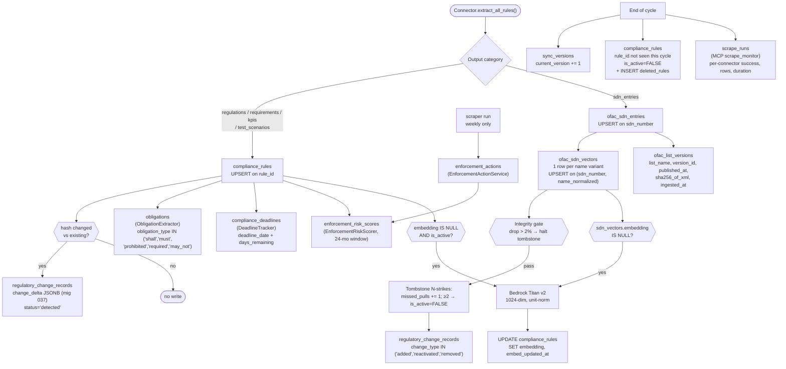
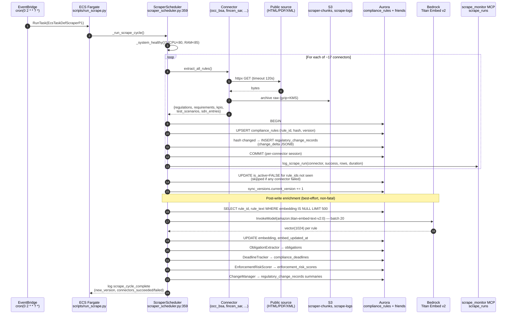
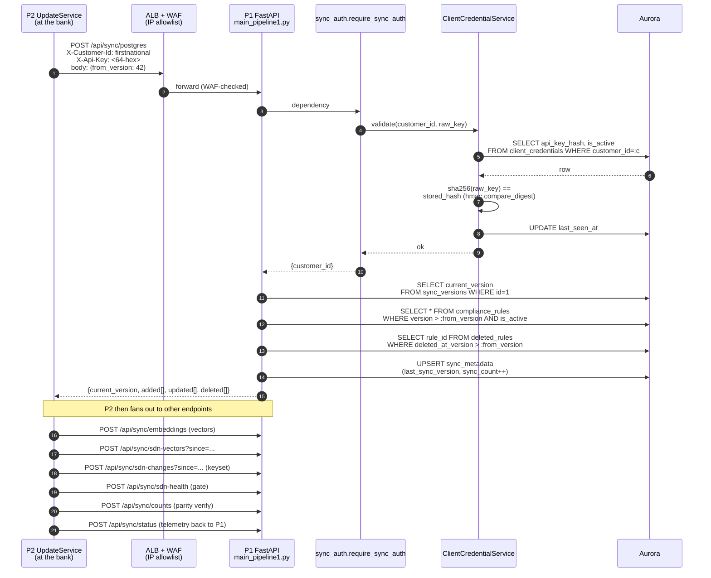
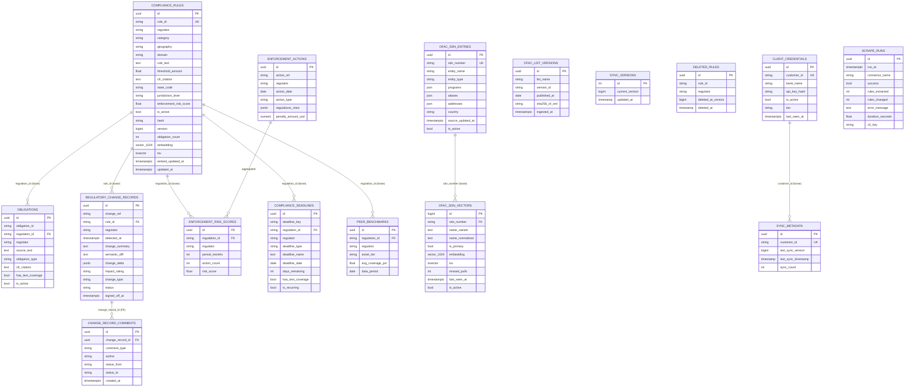

# Pipeline 1 — CCO Validation Walkthrough

**Audience:** Chief Compliance Officer reviewing Fortress Cloud (Pipeline 1) before
production sign-off.
**Scope:** Everything P1 collects, how it flows, where it lands, what it's
called, and what guarantees back each step.
**Mode constant:** `PIPELINE_MODE=pipeline1`.
**Source of truth:** All diagrams are generated from code — `file:line` refs are
inline so every box and arrow can be traced.

---

## 1. Sixty-second summary (what to tell the CCO first)

Pipeline 1 is a **read-only regulatory data plane**. Once a day, EventBridge
launches a Fargate task that scrapes ~17 federal + state regulators (plus
OFAC SDN), normalises and hashes everything, writes to a single Aurora
PostgreSQL cluster (pgvector + tsvector), then exposes versioned `/sync/*`
endpoints to customer banks (Pipeline 2). **No customer transaction data ever
enters P1.** The PII rejection middleware (`src/main_pipeline1.py:55`) blocks
anything that looks like an account number, SSN, or tax ID at the door.

- One compliance database, one bump of a global `sync_version` per cycle.
- Immutable audit trail per rule change (`regulatory_change_records` +
  `change_record_comments`, with a Postgres trigger that forbids editing a
  signed-off record).
- SDN list keeps a 1-row-per-name-variant denormalisation
  (`ofac_sdn_vectors`) with a published-source freshness anchor so the bank
  can attest "screened against OFAC list published at X, ingested with Y
  hours of lag".
- Auth to the sync API is per-bank HMAC (SHA-256 hash stored, raw key never
  persisted).

---

## 2. Architecture diagram

```mermaid
flowchart LR
  subgraph SRC["Regulatory sources (public)"]
    OCC["OCC handbook<br/>occ.gov"]
    FDIC["FDIC manual + FILs"]
    FFIEC["FFIEC BSA/AML<br/>(CF-gated — static fallback)"]
    FINCEN["FinCEN SAR/CDD"]
    CFPB["CFPB regs"]
    OFAC["OFAC SDN_ADVANCED.XML"]
    STATES["State regulators<br/>NY-DFS, CA-DFPI, TX-DOB,<br/>IL-IDFPR, FL-OFR"]
  end

  subgraph AWS["AWS — Fortress Cloud (P1)"]
    EB["EventBridge cron<br/>02:00 UTC daily"]
    ECS["ECS Fargate task<br/>EcsTaskDefScraperP1<br/>scripts/run_scrape.py"]
    API["ECS Fargate service<br/>EcsTaskDefApiP1<br/>main_pipeline1.py :8000"]
    S3RAW[("S3 — sdn_xml_raw/<br/>scrape-logs/")]
    S3CHK[("S3 — scraper-chunks/")]
    SEC["Secrets Manager<br/>fortress/p1/*"]
    BR["Bedrock<br/>Titan Embed v2<br/>(1024-dim)"]
    REDIS[("ElastiCache Redis<br/>resolver Tier-2 cache")]
    PG[("Aurora Postgres v2<br/>2–16 ACU<br/>pgvector + tsvector")]
    CW["CloudWatch + scrape_runs<br/>(MCP scrape_monitor)"]
    ALB["ALB — sync.fortresslabs.dev<br/>WAF: bank IP allowlist"]
  end

  subgraph CUST["Customer banks (P2)"]
    P2["P2 UpdateService<br/>HMAC: X-Customer-Id + X-Api-Key"]
  end

  SRC -->|httpx GET<br/>HTML / PDF / XML| ECS
  ECS -->|raw bytes,<br/>gzip + KMS| S3RAW
  ECS -->|per-cycle chunks| S3CHK
  ECS -->|UPSERT rules,<br/>obligations, deadlines,<br/>enforcement, SDN| PG
  ECS -->|InvokeModel<br/>batched 20| BR
  BR -->|vector(1024)| ECS
  ECS -->|UPDATE embedding,<br/>embed_updated_at| PG
  ECS -->|connector status,<br/>rows, duration| CW
  EB --> ECS
  SEC -.->|DB pwd, Redis token| ECS
  SEC -.->|DB pwd, Redis token| API
  PG --> API
  REDIS <--> API
  P2 -->|HTTPS<br/>POST /sync/*| ALB
  ALB --> API
  API -->|JSON: rules,<br/>embeddings, deltas,<br/>SDN variants| P2
```

**What this proves to the CCO:**
- Single ingress (EventBridge), single egress (ALB + WAF), one DB, one
  embedding model.
- Raw source bytes are retained in S3 (KMS-encrypted) for byte-for-byte
  replay — this is your evidence chain for "what did the regulator say on
  date X."
- Customer data never crosses into the AWS box on the left.

---

## 3. Data flow diagram (what gets stored, where, why)



**What this proves to the CCO:**
- Every regulatory mutation gets two records: the new state in
  `compliance_rules`, and a frozen-in-time diff in
  `regulatory_change_records.change_delta` (migration 037 — exists so the
  CCO review drawer shows what changed *when it was detected*, not whatever
  the rule looks like now).
- OFAC handling is split into three layers: raw entity, denormalised
  variants for screening, and a published-source attestation record.
- Tombstoning (soft deletes) is the only deletion path. Nothing is hard-
  deleted; rollback is always possible.

---

## 4. Sequence diagram — daily scrape cycle



**CCO sanity checks here:**
- "If a connector dies, do we silently lose rules?" → No.
  `scraper_scheduler.py:755` skips tombstoning when any connector failed —
  prevents misclassifying a scrape outage as a regulatory deletion.
- "How do we know we actually pulled today?" → `scrape_runs` table has one
  row per connector per day; the scrape_monitor MCP also emits CloudWatch
  metrics with both dimensioned + dimensionless heartbeats so an alarm fires
  if a cycle is silently skipped.

---

## 5. Sequence diagram — OFAC SDN (high-risk path)

```mermaid
sequenceDiagram
  autonumber
  participant OFAC as sanctionslistservice.ofac.treas.gov
  participant CON as ofac_sdn.py<br/>OfacSdnConnector
  participant S3R as S3 sdn_xml_raw/<br/>(KMS, gzip, retain 90d)
  participant LDR as ofac_sdn_loader.py
  participant PG as Aurora
  participant CHG as regulatory_change_records
  participant EMB as embed_sdn_variants.py<br/>(separate job)
  participant BR as Bedrock Titan v2

  CON->>OFAC: GET SDN_ADVANCED.XML (120s timeout)
  OFAC-->>CON: XML bytes + Last-Modified header
  CON->>S3R: archive_xml (date-partitioned, KMS)
  CON->>CON: parse profiles, aliases, programs,<br/>addresses, id_numbers, country
  CON-->>LDR: list of SDN entries
  LDR->>PG: UPSERT ofac_sdn_entries (sdn_number)
  LDR->>LDR: normalize_name(variant)<br/>NFD → strip accents → UPPER → no punct
  LDR->>PG: UPSERT ofac_sdn_vectors<br/>(sdn_number, name_normalized) — 1 row per variant
  LDR->>LDR: validate_pull_integrity<br/>(drop > 2% → PullIntegrityError)
  alt integrity passes
    LDR->>PG: tombstone_missing_variants:<br/>missed_pulls += 1; if ≥2 → is_active=FALSE
    LDR->>CHG: INSERT lifecycle:<br/>'added' | 'reactivated' | 'removed'
  else integrity fails
    LDR->>LDR: log error; SKIP tombstone (additive upserts already safe)
  end
  LDR->>PG: INSERT ofac_list_versions<br/>(version_id, published_at, sha256_of_xml,<br/>ingested_at)

  Note over EMB,BR: Async backfill (may run same cycle or after)
  EMB->>PG: SELECT id, name_normalized<br/>WHERE embedding IS NULL AND is_active
  EMB->>BR: Titan v2 — batched, semaphore=5
  BR-->>EMB: vector(1024) per variant
  EMB->>PG: UPDATE embedding, embedded_at
  Note over PG: HNSW index ix_sdn_vectors_embedding<br/>built CONCURRENTLY (migration 022)<br/>AFTER first backfill
```

**CCO sanity checks here:**
- "What if OFAC publishes a corrupted/empty XML?" → Pull-integrity gate at
  `ofac_sdn_loader.py:132` blocks deactivation when the entity count drops
  >2%. The day's adds still land (additive), but no SDN is silently
  unblocked.
- "What if a watchlisted entity is mistakenly removed?" → Two-strike soft
  deactivation. A single missing pull does nothing. Each lifecycle event is
  also written to `regulatory_change_records` so the bank's continuous-
  monitoring loop can rescreen on any "added"/"reactivated" delta.
- "How fresh is the SDN data right now?" → `/sync/sdn-health` returns
  `last_scraped_at`, hours since, total variants active, % embedded.
  `/sync/ofac-list-version` returns the source publication date + SHA-256
  of the XML — the bank includes both in its examination evidence pack.

---

## 6. Sequence diagram — customer bank (P2) pulling from P1



**CCO sanity checks here:**
- "What if the bank's key leaks?" → SHA-256(key) is what's stored. Raw key
  is shown once at provisioning, never logged. Rotation invalidates the old
  key on the next request — no grace window.
- "How does the bank confirm it has everything?" → After every pull, P2
  calls `/sync/counts` and compares per-table totals against P1. Mismatch
  triggers a re-pull.
- "Is the connection authenticated AND restricted?" → Two layers: WAF IP
  allowlist (only registered bank outbound IPs reach the ALB) plus per-
  request HMAC. PII rejection middleware also runs on every request so a
  bank that accidentally sends transaction data gets a 4xx, not silent
  acceptance.

---

## 7. DB schema — P1 entity-relationship diagram



**Schema rationale for the CCO:**
- Most cross-table links are **loose string keys** (`regulation_id`,
  `rule_id`, `regulator`, `sdn_number`), not enforced FKs, by design — the
  scraper writes each table independently per connector session, and an
  enforced FK would block partial-success cycles. Consistency is preserved
  by the scheduler (single writer per table per cycle) plus integrity gates
  on tombstoning.
- The two genuinely enforced FKs are
  `change_record_comments → regulatory_change_records` (audit trail
  consistency) and the immutability trigger
  `prevent_signoff_overwrite()` (mig `011_add_change_records.py:56`) which
  rejects any UPDATE that mutates `signed_off_at` once it's set.
- Vector + BM25 search runs on the same row: `compliance_rules.embedding`
  (HNSW, m=16, ef_construction=64) is paired with `compliance_rules.tsv`
  (`GENERATED ALWAYS STORED` over `rule_text || cfr_citation || regulator`,
  GIN-indexed). Hybrid query is 70% cosine + 30% `ts_rank` (see
  `compliance_rule_resolver.py:378`).

---

## 8. What data is collected, per source

| Connector file | Regulator | Source (URL or feed) | Output → table | CCO note |
|---|---|---|---|---|
| `ofac_sdn.py` | OFAC | `sanctionslistservice.ofac.treas.gov/.../SDN_ADVANCED.XML` (daily) | `ofac_sdn_entries`, `ofac_sdn_vectors`, `ofac_list_versions`, `regulatory_change_records` | Raw XML kept in S3; SHA-256 + published date held in `ofac_list_versions` for attestation |
| `occ_bsa.py` | OCC | OCC Comptroller's Handbook (HTML + PDF) | `compliance_rules` (category `bsa_aml`) | Wire dual-approval, CTR, SAR, CDD thresholds |
| `ffiec_bsa.py` | FFIEC | `bsaaml.ffiec.gov` (CF-gated → static fallback, see memory `project_ffiec_cf_gated`) | `compliance_rules` (`bsa_aml`, `cip`, `due_diligence`) | Static fallback is authoritative — flag this to CCO; we cannot live-scrape this site |
| `ffiec_call_report.py` | FFIEC | FDIC Form 031 / Call Report | `compliance_rules` (`call_report`) | |
| `ffiec_cybersecurity.py` | FFIEC | FFIEC cybersecurity exam guidance | `compliance_rules` (`cyber`) | |
| `fdic.py` | FDIC | `fdic.gov/consumer-compliance-examination-manual/` + FIL discovery | `compliance_rules` (`compliance_manual`, `fils`, `capital_adequacy`) | |
| `fincen_sar.py` | FinCEN | `fincen.gov/resources/filing-information` | `compliance_rules` (`sar`) | $0 insider abuse, $5K identified, $25K unidentified, 30-day deadline |
| `cfpb.py` | CFPB | `consumerfinance.gov` | `compliance_rules` (`udaap`, `tila`, `fcra`, `ecoa`, `1071`, `hmda`) | |
| `cra.py` | CRA / FRB | `federalreserve.gov/communitydev/cra_about.htm` | `compliance_rules` (`cra`) | |
| `irr.py` | OCC | OCC IRR guidance | `compliance_rules` (`interest_rate_risk`) | |
| `cre_concentration.py` | OCC/FDIC/FFIEC joint | CRE concentration guidance | `compliance_rules` (`cre_concentration`) — 100% / 300% thresholds | |
| `liquidity_risk.py` | OCC | LCR / NSFR / intraday liquidity | `compliance_rules` (`liquidity`) | |
| `operational_risk.py` | FFIEC | Op risk framework, BCM, cyber | `compliance_rules` (`operational_risk`) | |
| `cecl.py` | FFIEC | ASC 326 CECL provisioning | `compliance_rules` (`cecl`) | |
| `states/*` (NY-DFS, CA-DFPI, TX-DOB, IL-IDFPR, FL-OFR) | State | State regulator portals | `compliance_rules` with `state_code` + `jurisdiction_level='state'` | |
| `peer_benchmarks.py` | n/a — internal aggregation | Anonymised customer-bank coverage | `peer_benchmarks` | Asset-tier banded; no individual bank identifiable |

**Enrichment writers** (not connectors, run after scrape):
- `ObligationExtractor` → `obligations` (one row per "shall/must/required"
  clause inside a rule).
- `EnforcementActionService` (weekly) → `enforcement_actions`.
- `EnforcementRiskScorer` → `enforcement_risk_scores` (24-month rolling).
- `DeadlineTracker` → `compliance_deadlines` (with `days_remaining`).
- `ChangeManager` → `regulatory_change_records` (semantic summaries on top
  of the hash-detected raw mutations).

---

## 9. Naming conventions — `rule_id` and friends

The convention is **`{REGULATOR}-{CATEGORY}-{SUBCATEGORY?}-{SEQ}`**, all
upper-case, hyphen-separated. Examples actually present in the connectors:

| Pattern | Example | Source |
|---|---|---|
| Federal, single agency + topic | `OCC-BSA-WIRE-001` | `occ_bsa.py` |
| Federal, agency + sub-rule | `OCC-BSA-WIRE-001-R1` | sub-requirements get `-R{n}` suffix |
| FinCEN SAR family | `FINCEN-SAR-TRIG-001`, `FINCEN-SAR-DEADLINE-001`, `FINCEN-SAR-FIELD-001` | `fincen_sar.py` |
| CFPB regulations | `CFPB-1071-001`, `CFPB-HMDA-001`, `CFPB-REGB-001`, `CFPB-REGE-001` | `cfpb.py` |
| CRE concentration | `CRE-CONC-001` | `cre_concentration.py` |
| State regulator | `CA-DFPI-FAIR-001`, `NY-DFS-BITLICENSE-001`, `TX-DOB-LOAN-001` | `states/*.py` |
| OFAC SDN — entity row | `sdn_number` = numeric UID from SDN XML, e.g. `11234` | `ofac_sdn_entries.sdn_number` |
| OFAC SDN — variant row | composite key `(sdn_number, name_normalized)` | `ofac_sdn_vectors` |
| Change record reference | `change_ref` = `CHG-YYYY-MM-DD-NNN` | `regulatory_change_records.change_ref` |
| Bank API key holder | `customer_id` = lowercase bank slug, e.g. `firstnational`, `testbank` | `client_credentials.customer_id` |

**Lookup keys the CCO will care about:**
- `cfr_citation` — verbatim regulator string, e.g. `"31 CFR 1020.210"`,
  `"12 CFR 225.100(a)"`. Connectors own the formatting; resolver does no
  normalisation.
- `state_code` — two-letter (`"CA"`, `"NY"`, `"TX"`) or compound
  (`"NY-DFS"`); the column was widened to 20 chars in migration 014 to
  support compound codes (memory `project_p1_secret_rotation_gap` and the
  migration history both flag this).
- `jurisdiction_level` — `"federal"` or `"state"`. Set by the connector at
  insert time.

---

## 10. Audit, immutability, and lineage controls (CCO talking points)

| Question the CCO will ask | Where the answer is wired |
|---|---|
| "Can someone alter a signed-off change record?" | No. Postgres trigger `prevent_signoff_overwrite()` (`alembic/versions/011_add_change_records.py:56`) raises if `signed_off_at` is non-null on UPDATE. |
| "Can I reconstruct what the regulator said on day X?" | Yes. Raw scrape bytes land in S3 (`scraper-chunks/`, `sdn_xml_raw/`, KMS-encrypted, versioned). For OFAC specifically, `ofac_list_versions` carries `published_at` + `sha256_of_xml` so you can prove the document identity. |
| "How do I know yesterday's cycle actually ran?" | `scrape_runs` table has one row per connector per day (mig 018). MCP scrape_monitor also emits CloudWatch metrics with paired dimensioned + dimensionless heartbeats (memory `feedback_cw_alarm_dimension_split`), so absence triggers an alarm. |
| "What stops a bug from silently deleting an active SDN?" | Two gates. (1) `validate_pull_integrity()` halts tombstoning if entity count drops >2%. (2) N-strikes soft deactivate (≥2 consecutive misses) before `is_active=FALSE`. Hard-delete is not a code path. |
| "What stops customer PII from being ingested into the regulatory plane?" | `PIIRejectionMiddleware` at `main_pipeline1.py:55` blocks any request whose query params or JSON body look like account numbers, SSNs, or tax IDs — returns 4xx before the handler runs. |
| "How do we prove which bank pulled what?" | `sync_metadata.last_sync_version` per `customer_id` plus `last_sync_timestamp` and a monotonic `sync_count`. P2 also reports back via `POST /sync/status`. |
| "Can a leaked API key be revoked instantly?" | Yes. `client_credentials.is_active=FALSE` causes the next request to 401 (`client_credential_service.validate` checks active flag before constant-time hash compare). Rotation generates a new key and invalidates the old immediately — no grace window. |
| "Are we using the right embedding model and dimensions?" | Bedrock `amazon.titan-embed-text-v2:0`, 1024-dim, unit-norm (cosine ≡ dot product). HNSW index params: `m=16, ef_construction=64`, query-time `ef_search=100`. Migration 023 sets up the column + index. |

---

## 11. Migration timeline (for the CCO appendix)

| Mig | Table touched | What it does |
|---|---|---|
| 007 | `ofac_sdn_entries` | + `country`, `nationality` |
| 008 | `obligations`, `coverage_snapshots` | Per-rule obligation extraction + coverage telemetry |
| 009 | `enforcement_actions`, `enforcement_risk_scores` | Enforcement audit log + 24-mo risk score |
| 010 | `compliance_deadlines` | Filing/effective-date tracker with `days_remaining` |
| 011 | `regulatory_change_records`, `change_record_comments` | Change workflow + signoff immutability trigger |
| 012 | `peer_benchmarks` | Asset-tier banded peer coverage |
| 013 | `compliance_rules` | + `cfr_citation`, `state_code`, `jurisdiction_level`, `enforcement_risk_score`, `obligation_count`, `change_delta`, `change_type` |
| 014 | `compliance_rules` | `state_code` widened 10 → 20 chars |
| 015 | `client_credentials` | Per-bank API key store (SHA-256 hashes only) |
| 018 | `scrape_runs` | Per-connector execution log (MCP scrape_monitor) |
| 019 | `compliance_rules` | + `embed_updated_at`, partial index `idx_cr_embed_stale` |
| 020 | `regulatory_change_records` | All `*_at` columns → `TIMESTAMPTZ` |
| 021 | `ofac_sdn_vectors` | New 1-row-per-variant table + GIN trgm + tsv trigger |
| 022 | `ofac_sdn_vectors` | HNSW index `CONCURRENTLY` (run **after** embed backfill) |
| 023 | `compliance_rules` | + `embedding vector(1024)`, generated `tsv`, HNSW + GIN indexes |
| 037 | `regulatory_change_records` | + `change_delta` JSONB per-record (frozen diff at detection time) |

(Migrations 016/017 are P2-only and intentionally absent from this walkthrough.)

---

## 12. Where to look in the code (one-page index for follow-up)

| Topic | File:line |
|---|---|
| FastAPI app, routing, PII middleware | `src/main_pipeline1.py:1–246` |
| Sync API (all `/api/sync/*` endpoints) | `src/api/sync_api.py:1–1094` |
| HMAC auth on every sync request | `src/api/sync_auth.py:30–56` |
| Credential lifecycle (provision/rotate/verify/suspend) | `src/services/client_credential_service.py:26–200` |
| Scraper orchestrator (entry of every cycle) | `src/services/scraper_scheduler.py:359–837` |
| Cycle entrypoint script (ECS command) | `scripts/run_scrape.py:41–73` |
| Connectors (per regulator) | `src/connectors/regulatory/usa/*.py` |
| OFAC loader (normalise, integrity, tombstone, list version) | `src/services/ofac_sdn_loader.py:1–280` |
| Embedding job for SDN variants | `src/jobs/embed_sdn_variants.py` |
| 3-tier compliance rule resolver | `src/services/compliance_rule_resolver.py:121–577` |
| MCP scrape_monitor server | `src/mcp_servers/scrape_monitor/server.py` |
| All ORM models | `src/models/database.py` |
| Alembic migrations | `alembic/versions/` |
| CloudFormation (P1) | `infra/cloudformation/pipeline1-{vpc,data,compute,security,billing}.yml` |
