# Pipeline 2 — CCO & Business-User Walkthrough

**Audience:** Chief Compliance Officer + business stakeholders validating the
bank-side product (CCO Dashboard, validators, 6-agent test-generation pipeline,
exports).
**Scope:** Everything P2 does inside the bank's VPC — runtime gates,
dashboard panels, naming conventions, audit/evidence flow.
**Mode constant:** `PIPELINE_MODE=pipeline2`.
**Companion doc:** [PIPELINE1_CCO_WALKTHROUGH.md](./PIPELINE1_CCO_WALKTHROUGH.md)
for the regulatory data plane that feeds P2.

This doc is organised around **business use cases**. Each use case has its
own sequence diagram + data-flow notes + dashboard panel mapping so a CCO can
walk one screen at a time.

---

## 1. Sixty-second summary

P2 is the bank-side deployment — one ECS Fargate cluster + Aurora + Cognito-
gated React dashboard per bank. It does **three jobs**:

1. **Runtime compliance gates** — wire, OFAC, loan validators sit in front of
   core banking calls. Customer transaction data never leaves the bank.
2. **CCO dashboard** — 13 panels covering rule inventory, regulatory-change
   review with sign-off, OFAC case management, examination readiness,
   workflow status, and audit-grade exports.
3. **6-agent JIRA pipeline** — story → discovery → understanding → framework →
   Bedrock test code → validation → GitHub PR + obligation-coverage writeback.

Everything the bank consumes — rules, OFAC list, change records — is **pulled
daily from P1** via the sync API (read-only, HMAC-authenticated). Everything
the bank produces — screenings, validations, cases, findings, exports —
**stays in the bank's Aurora**. Examination evidence lands in an S3 bucket
with Object-Lock COMPLIANCE mode (WORM, 7-year retention).

---

## 2. Architecture diagram

```mermaid
flowchart LR
  subgraph P1["P1 — Fortress Cloud (shared)"]
    P1API["/api/sync/*<br/>HMAC-authenticated"]
  end

  subgraph BANK["Bank deployment (P2) — inside customer VPC"]
    direction TB
    subgraph EDGE["Edge"]
      CF["CloudFront + WAF<br/>(blocklist IPSet + XFF rule)"]
      ALB["ALB"]
    end
    subgraph APP["ECS Fargate (2–10 tasks)"]
      MAIN["main_pipeline2.py FastAPI<br/>routers: webhooks, approvals,<br/>validate, screening, dashboard,<br/>exports, internal/sync"]
      UPD["UpdateService<br/>(daemon thread or one-shot)"]
      AGENTS["6-agent pipeline<br/>discovery → understanding →<br/>framework → generation →<br/>validation → execution"]
    end
    subgraph DATA["Data plane"]
      PG[("Aurora Postgres v2<br/>pgvector + tsvector<br/>~23 P2 tables")]
      REDIS[("ElastiCache Redis<br/>resolver Tier-2 cache")]
    end
    subgraph WORKER["Exports worker (separate ECS TD)"]
      EXP["exports/worker.py<br/>snapshot → canonical → render"]
    end
    subgraph STORE["Storage"]
      S3EXP[("S3 — exports bucket<br/>Object-Lock COMPLIANCE<br/>7-year retention")]
    end
    subgraph IDP["Identity"]
      COG["Cognito User Pool<br/>groups: Analyst, CCO,<br/>CRO, Admin"]
    end
    SEC["Secrets Manager<br/>/fortress/{bank_id}/*<br/>SSM Parameters"]
    BR["Bedrock<br/>Claude Sonnet 4 (codegen)<br/>Titan Embed v2 (vectors)"]
  end

  subgraph EXT["External systems"]
    CORE["Core banking system<br/>(wire, loan, KYC)"]
    JIRA["JIRA Cloud (MDP project)"]
    GH["GitHub repo"]
  end

  CORE -->|POST /validate/wire-transfer<br/>POST /validate/ofac-screen<br/>POST /validate/loan-application| ALB
  CF --> ALB
  JIRA -->|POST /webhooks/jira<br/>HMAC / Bearer auth| ALB
  ALB --> MAIN
  MAIN <--> PG
  MAIN <--> REDIS
  MAIN --> COG
  MAIN -->|InvokeModel<br/>(agents)| BR
  SEC -.-> MAIN
  SEC -.-> UPD
  UPD -->|HMAC sync calls<br/>(daily or EventBridge)| P1API
  P1API -->|rules, embeddings,<br/>SDN entries+variants,<br/>changes, deadlines| UPD
  UPD --> PG
  MAIN -->|enqueue artifact| EXP
  EXP <--> PG
  EXP -->|PUT-if-absent<br/>+ Object Lock| S3EXP
  AGENTS -->|create PR| GH
  AGENTS -->|comment| JIRA
```

**One-line CCO summary:** the bank's compliance brain (P2) reads from the
regulatory plane (P1), enforces gates on real banking calls, and gives the
CCO a single dashboard + a tamper-evident evidence drawer.

---

## 3. Naming conventions — the ID glossary

This is what every CCO/auditor first asks for. All formats are real (from
code or migrations).

| Identifier | Where it lives | Format | Real example | Notes |
|---|---|---|---|---|
| `bank_id` | `bank_profile.bank_id` | lower-case slug, no underscore | `testbank`, `firstnational` | Per memory `project_p2_test_bank_id` |
| `customer_id` | env / SSM, used as HMAC `X-Customer-Id` to P1 | same as bank_id | `firstnational` | One per bank |
| `rule_id` | synced from P1 `compliance_rules` | `{REGULATOR}-{CATEGORY}-{SUBCATEGORY?}-{SEQ}` | `OCC-BSA-WIRE-001`, `CFPB-1071-001`, `FINCEN-SAR-TRIG-001` | Same convention as P1 |
| `obligation_id` | synced from P1 `obligations` | `{REGULATOR}-{RULE}-{TYPE}-{SEQ}` | `FINCEN-SAR-TRIG-001`, `OCC-BSA-WIRE-001-R1` | `obligation_type` ∈ {shall, must, prohibited, required, may_not} |
| `change_ref` | `regulatory_change_records.change_ref` | `CHG-YYYY-MM-DD-NNN` (or `CR-…` for some sources) | `CHG-2026-06-30-001` | Stable across P1 ↔ P2 |
| `workflow_id` | `workflow_executions.id` | UUID v4 | `550e8400-e29b-41d4-a716-446655440000` | Generated on JIRA webhook |
| `jira_story_key` | `workflow_executions.jira_story_key` | `MDP-NNN` (MDP project, Idea issuetype) | `MDP-42`, `MDP-105` | Per memory `project_jira_mdp_idea_issuetype` |
| `policy_ref` | `bank_policies.policy_ref` | `POL-YYYY-CATEGORY-NNN` | `POL-2026-BSA-001` | Unique per `(policy_ref, client_id)` |
| `policy_id` | `bank_policies.id` | UUID v4 | — | Used as FK target |
| `screening_id` | `screening_events.screening_id` | VARCHAR(64) — caller-supplied idempotency key | UUID or `SCREENING-20260630-000001` | Caller chooses; SHA-256 of criteria gives 24h dedup |
| `criteria_hash` | `screening_events.criteria_hash` | SHA-256 hex (64 chars) | — | Dedup identical re-screens within 24h |
| `case_id` | `screening_cases.case_id` | `CASE-YYYY-MM-NNNNNN` | `CASE-2026-06-000152` | One open case per `(external_customer_id, sdn_number)` |
| `sdn_number` | from OFAC XML, synced | numeric UID from OFAC | `3526`, `11234` | — |
| `screening_rule_id` | `screening_rules.rule_id` | `OFAC-SCREEN-{TYPE}-NNN` | `OFAC-SCREEN-FUZZY-001`, `OFAC-SCREEN-OWN50-001`, `OFAC-SCREEN-FRESH-001`, `OFAC-SCREEN-CLEAN-001` | Seeded by migration 034 |
| `control_id` | `controls.control_id` | `CTRL-{DOMAIN}-NNN` | `CTRL-BSA-KYC-001` | One row per bank control |
| `test_id` | `control_tests.test_id` | `TEST-{control_id}-{framework}-NNN` | `TEST-CTRL-BSA-KYC-PYTEST-001` | Links to JIRA story + PR |
| `execution_id` | `test_executions.execution_id` | UUID v4 | — | One per pytest sandbox run |
| `finding_id` | `findings.finding_id` | `FIND-YYYY-MM-{BANK}-NNN` | `FIND-2026-06-TESTBANK-001` | OCC 5-Cs structure |
| `artifact_id` | `export_artifacts.artifact_id` | UUID v4 (also used in S3 key) | — | One per generated report |
| `version_hash` | `export_artifacts.version_hash` | first 7 hex of canonical SHA-256 | `4a1f93c` | Idempotency: same as_of + same source = same hash = same artifact |
| `validation_id` | `ofac_validations.validation_id` | UUID v4 | — | Annual OFAC independent test |
| `person_id` | `bank_officers.person_id` | UUID v4 | — | Officer roster |
| `vocab_version` | `vocab_versions.version_id` | `YYYY-MM-DD-{tag}` | `2026-06-01-alpha`, `q18-final` | Frozen enum vocabulary snapshot |

**Three rules of thumb to give the CCO:**
1. Anything ending in `_ref` or `_key` is a **string natural key** the human
   reads (e.g. `change_ref`, `policy_ref`, `jira_story_key`).
2. Anything ending in `_id` is **either a UUID** (machine key) **or a
   prefixed string** if the row also needs to be human-recognisable
   (control_id, case_id, finding_id, test_id, screening_rule_id).
3. `rule_id` and `obligation_id` are **synced from P1 verbatim** — P2 never
   mints new ones; it only references them.

---

## 4. Business use cases — sequence + data flow per scenario

Every use case below has the same shape: **trigger → actors → sequence
diagram → what got written → which dashboard panel it surfaces in**.

### UC-1: Daily sync — P2 pulls fresh rules + OFAC list from P1

**Who triggers it:** background daemon (`UpdateService`) or EventBridge.
**Frequency:** every `SYNC_INTERVAL_HOURS` (default 24) or on-demand via
`POST /internal/sync/trigger`.

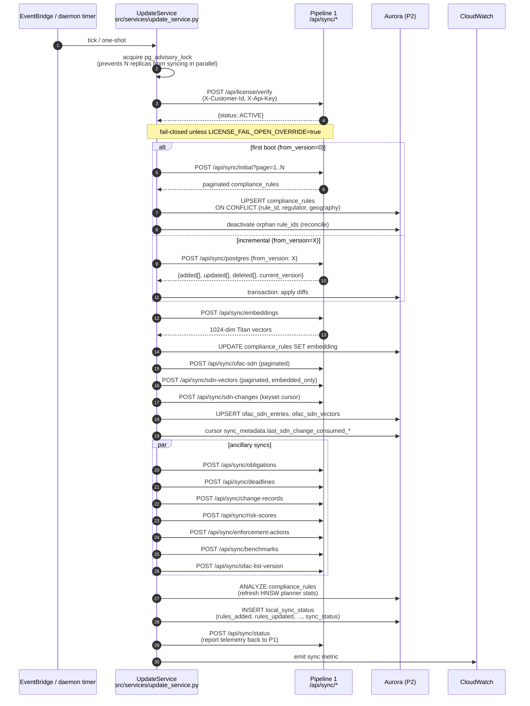

**Tables written this cycle:** `compliance_rules`, `obligations`,
`compliance_deadlines`, `regulatory_change_records`, `enforcement_actions`,
`enforcement_risk_scores`, `peer_benchmarks`, `ofac_sdn_entries`,
`ofac_sdn_vectors`, `ofac_list_versions`, `sync_metadata`, `local_sync_status`.

**Idempotency:** every write is `ON CONFLICT … DO UPDATE` keyed on a natural
unique constraint, so re-running a failed cycle is safe.

**Backoff:** `_post_with_retry()` does exponential backoff (1s, 2s, 4s, 8s)
on network errors and 5xx/429. 401/403 → re-raise immediately (auth issue).

**Surfaces in dashboard:** `/health/sync` endpoint and the readiness panel's
"engine integrity" lens (CIO view).

---

### UC-2: CCO reviews a regulatory change & signs it off

**Who triggers it:** CCO opens the `Changes` panel, drills into a row,
records a disposition + signs off.

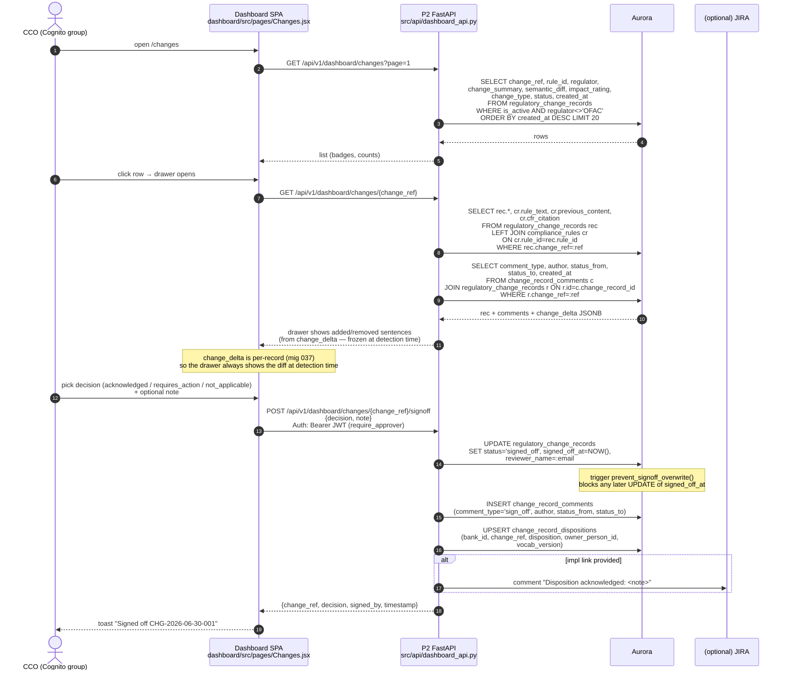

**Dashboard panels touched:** Panel 3 — `Changes` (list + drawer + signoff
modal). Also surfaces in: readiness scorecard ("changes signed off") and
exports (Report 5 — Regulatory change log).

**Tables written:** `regulatory_change_records` (status + signed_off_at),
`change_record_comments` (audit row), `change_record_dispositions` (per-bank
disposition with frozen `vocab_version`).

**What the CCO can prove with this:** every regulator-side change has a
named reviewer, a timestamped sign-off (immutable thanks to the Postgres
trigger), and an optional bank disposition tied to a vocab version that's
frozen at the moment of sign-off.

---

### UC-3: Wire transfer validation (runtime gate)

**Who triggers it:** core banking calls `POST /validate/wire-transfer`
before releasing a wire. Reachable only from inside the bank's VPC.

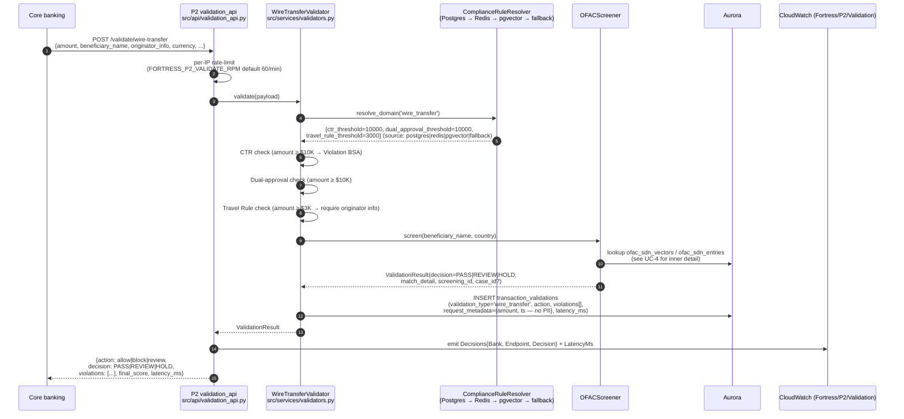

**Decision matrix the CCO will ask about:**

| Amount | OFAC result | Dual approval present | → Result |
|---|---|---|---|
| < $3K | clear | — | PASS, no flags |
| $3K – $10K | clear | — | PASS, Travel Rule check on originator info |
| ≥ $10K | clear | yes | PASS, CTR filing flagged |
| ≥ $10K | clear | no | REVIEW (dual approval missing) |
| any | fuzzy 0.85–0.92 | — | REVIEW + case opened |
| any | match ≥ 0.92 | — | HOLD + case opened (priority HIGH) |
| any | SDN list > 36h stale | — | HOLD (FRESH-001 staleness gate) |
| any | SDN list 24–36h stale | — | bump one level (PASS→REVIEW or REVIEW→HOLD) |

**Tables written:** `transaction_validations` (audit row, no PII), plus
whatever OFAC screen wrote (`screening_events` always, `screening_cases` on
REVIEW/HOLD).

**Dashboard panels touched:** none directly — validators are silent gates.
Their output rolls up into readiness (Panel 1) and into cases (Panels 10–11)
when OFAC fires.

---

### UC-4: OFAC SDN screen from the dashboard (real-time)

**Who triggers it:** an Analyst (or CCO) opens the SDN Search panel and
screens a party.

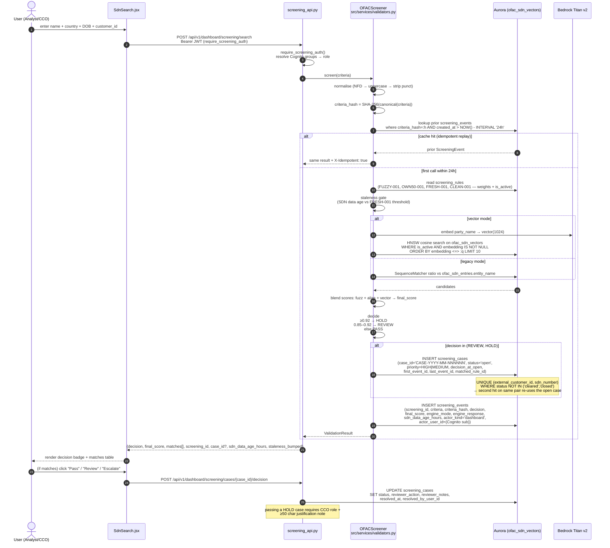

**Dashboard panels touched:**
- Panel 9 — **SDN Search** (this flow's start)
- Panel 10 — **Screening Cases** (list view of all open cases)
- Panel 11 — **Investigation** (drill-down + decision recording)
- Panel 12 — **Rules Performance** (FUZZY-001/OWN50-001/FRESH-001/CLEAN-001
  weights + alert volume by decision)
- Panel 13 — **Executive Today** (today's screenings, matches, HP cases)
- Panel 6 — **OFAC / SDN Engine Health** (freshness gauge, counts)
- Bonus — **Vector Intelligence** (Admin/CRO — embedding coverage, similarity
  distribution last 30d, engine mode A/B split)

**Tables written:** `screening_events` (always, immutable), `screening_cases`
(on REVIEW/HOLD), `screening_case_events` (join row linking new event to
existing case on re-hit).

**Auditor proof points:** every screen has a row in `screening_events` with
`actor_kind` + `actor_user_id` (who screened), `criteria` (what was
screened, PII stays P2-local), `engine_mode` (legacy vs vector for A/B
analysis), and `sdn_data_age_hours` (freshness at decision time).

---

### UC-5: Loan application validation (Section 1071 + ECOA + HMDA)

**Who triggers it:** loan origination system calls `POST /validate/loan-application`.

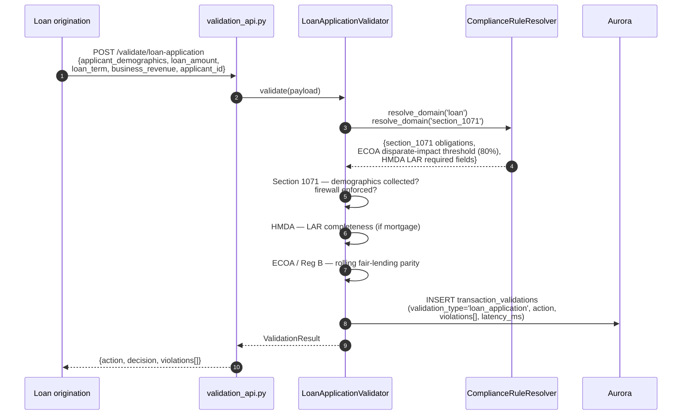

**Dashboard panels touched:** rolls up into Panel 1 (readiness) and Panel 2
(compliance rules — fair-lending obligations). No dedicated loan panel
exists yet (gap, flag to CCO).

---

### UC-6: JIRA story → 6-agent pipeline → GitHub PR

**Who triggers it:** developer writes a JIRA story in the MDP project
(issuetype = Idea). JIRA Cloud fires the webhook.

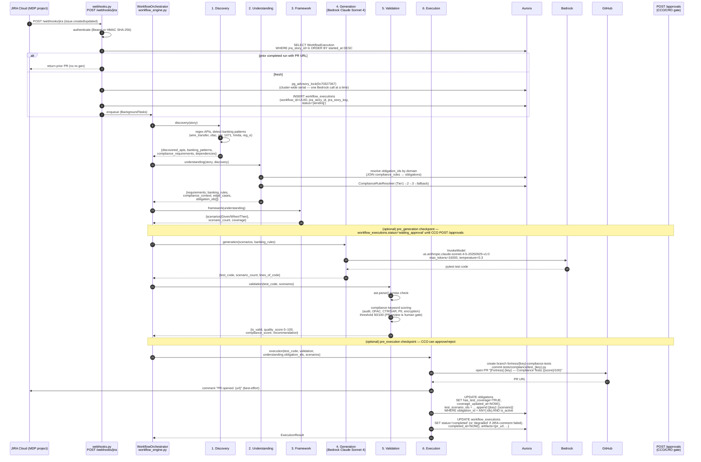

**Dashboard panels touched:**
- Panel 7 — **Workflows** (status, duration, PR link)
- Panel 4 — **Obligations** (coverage %)
- Panel 2 — **Compliance Rules** (test_count per rule via join to workflow_executions)
- Panel 1 — **Readiness** (testing dimension)

**Tables written:** `workflow_executions` (create + status updates),
`checkpoint_approvals` (when CCO approves/rejects), `obligations.has_test_coverage`
(coverage writeback), `obligations.test_scenario_ids` (scenario IDs:
`{jira_key}::{scenario_name}`). Also: GitHub PR (external), JIRA comment
(external, best-effort).

**Safety properties:**
- One-in-flight per story: partial unique index
  `uq_workflow_jira_story_inflight` (mig 033) keeps webhook retries from
  spawning parallel runs.
- Single Bedrock call cluster-wide: advisory lock `0x70327367` (prevents
  Bedrock quota thrashing across ECS tasks).
- Test runner is fully sandboxed (`PYTHONPATH` intentionally excluded so
  generated tests can't pull production modules).

---

### UC-7: Generate an examiner package (CCO clicks "Export")

**Who triggers it:** CCO/CRO opens Reports panel, picks a report type +
format + as-of date, clicks Generate.

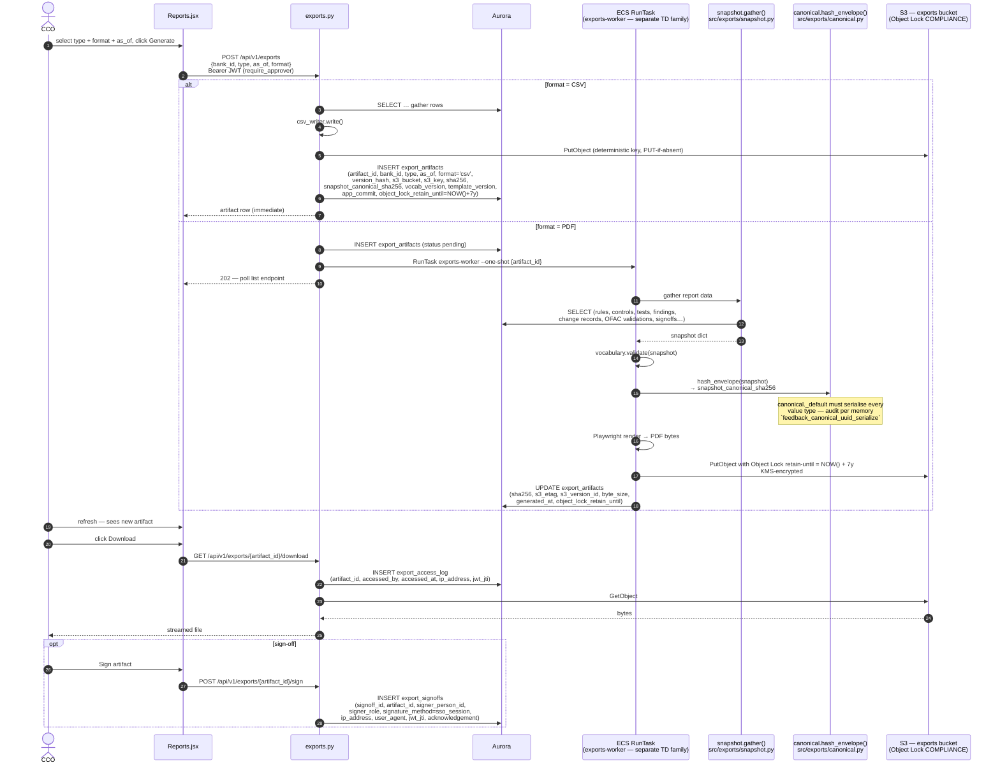

**Six report types** (`export_artifacts.type` CHECK constraint):

| Type | What it proves | Source tables |
|---|---|---|
| `examiner_package` | Full obligation inventory → mapped control → test result → JIRA/PR trace | `compliance_rules`, `obligations`, `controls`, `control_rule_mappings`, `control_tests`, `test_executions`, `workflow_executions` |
| `ofac_attestation` | OFAC list freshness + tested screening controls + completeness | `ofac_list_versions`, `ofac_sdn_vectors`, `screening_rules`, `screening_events`, `screening_cases`, `ofac_validations` |
| `board_report` | Quarterly coverage trend, changes signed off, open findings | `obligations`, `regulatory_change_records`, `findings` |
| `mra_tracker` | Each finding with owner, deadline, status, closure evidence | `findings`, `finding_history`, `bank_officers` |
| `change_log` | Dated signed-off record of every change + bank disposition | `regulatory_change_records`, `change_record_comments`, `change_record_dispositions` |
| `coverage` | Mapped rules vs tested rules (mock-exam self-assessment) | `compliance_rules`, `control_rule_mappings`, `control_tests`, `workflow_executions` |

**Idempotency:** `UNIQUE (bank_id, type, as_of, version_hash)` on
`export_artifacts`. Same as-of + same source data → same canonical hash →
same artifact returned (no re-render).

**Tamper evidence:** every artifact carries `sha256` of bytes,
`snapshot_canonical_sha256` of input, `vocab_version` (frozen enum
snapshot), `template_version`, `app_commit`. S3 Object Lock COMPLIANCE +
KMS makes them deletable only after `object_lock_retain_until`.

**Dashboard panels touched:** Panel 8 — **Reports**.

---

### UC-8: Policy gap analysis (Panel 6)

**Who triggers it:** CCO maintains the bank's internal-policy register and
wants to see which regulations are not yet covered by an active policy.

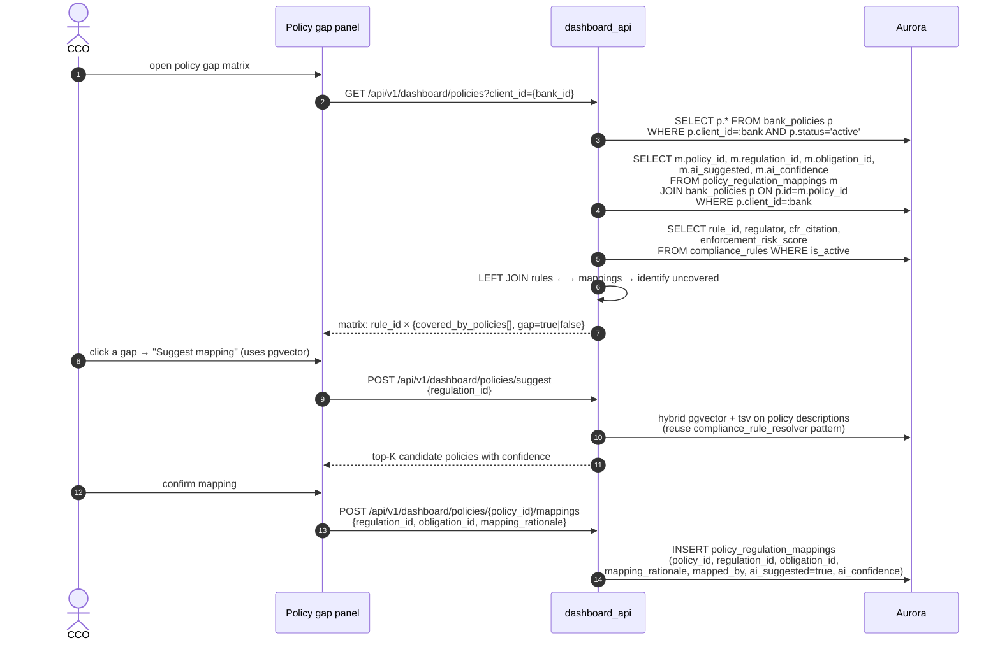

**Dashboard panel:** (not yet wired in UI per dashboard inventory — backend
endpoints exist; flag as a near-term build).

**Tables written:** `policy_regulation_mappings` (one INSERT per mapping;
`UNIQUE (policy_id, regulation_id)`).

---

### UC-9: Case management — Analyst clears a REVIEW case

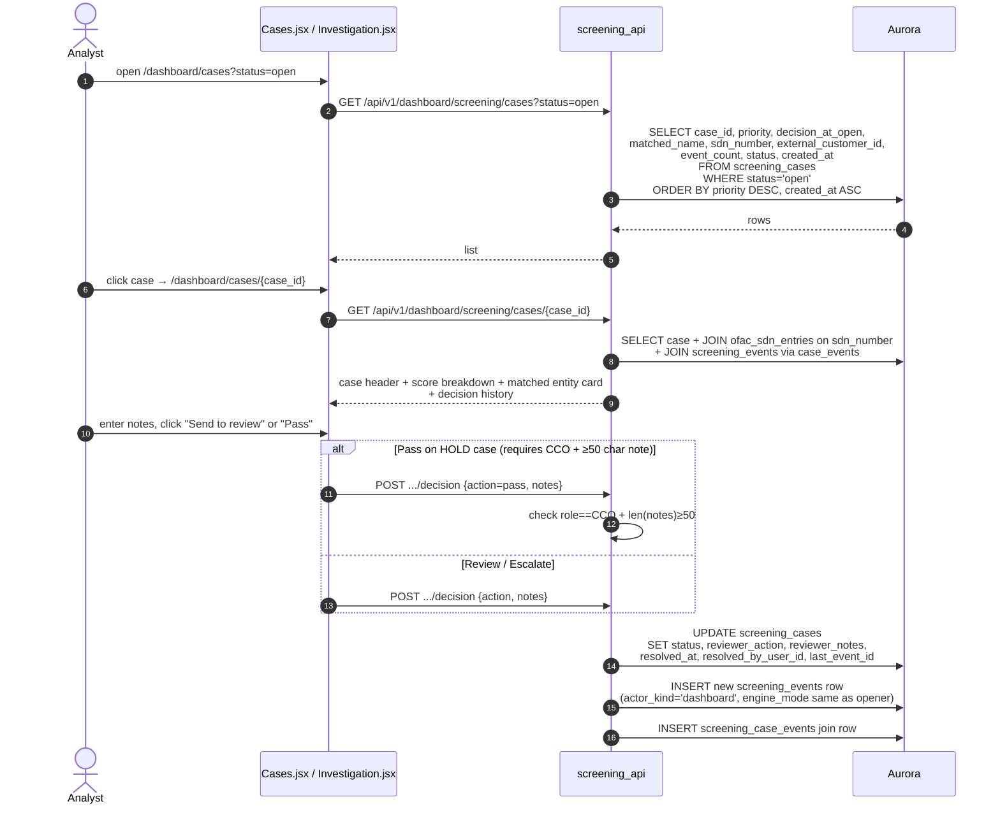

**Dashboard panels touched:** Panel 10 (cases list) and Panel 11 (investigation).

**Tables written:** `screening_cases` (status update), `screening_events`
(new audit row for the decision), `screening_case_events` (join).

**Auditor-friendly properties:** decision history table on the
Investigation panel is just `SELECT … FROM screening_events WHERE id IN
(case.first_event_id, case_events…) ORDER BY created_at` — there's no
hidden state.

---

### UC-10: Executive readiness scorecard (CCO/CRO/CIO)

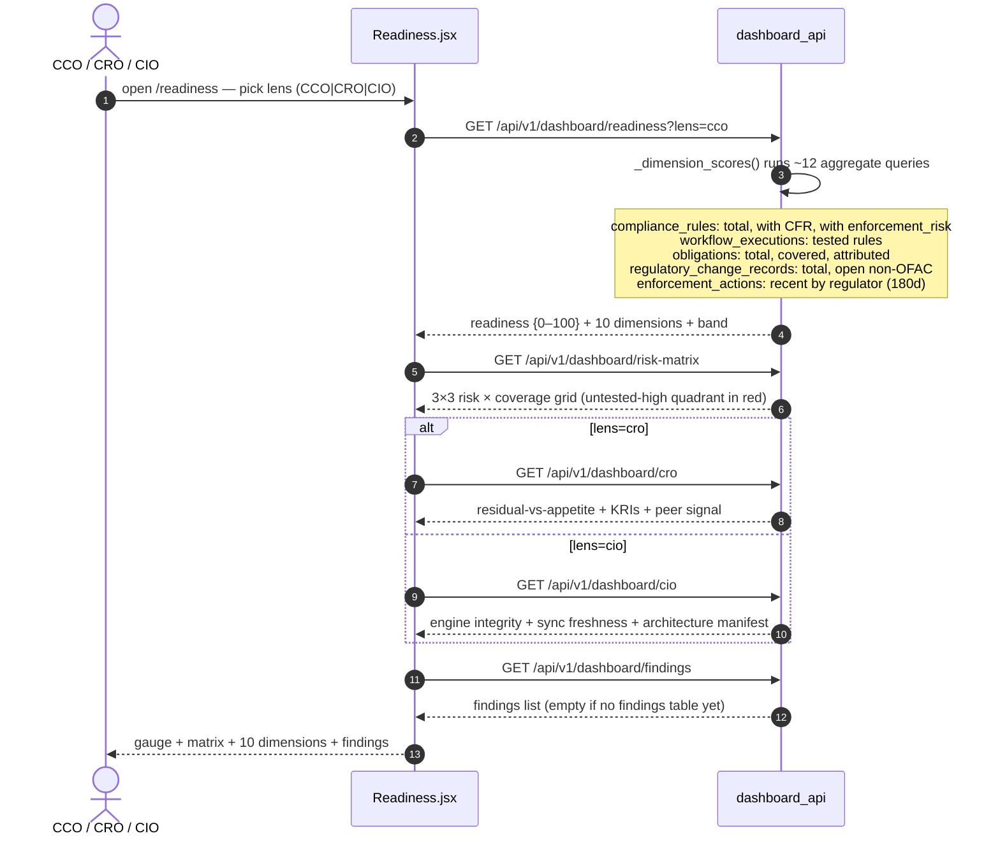

**Dashboard panel:** Panel 1 — **Readiness**.

**Tables read (no writes):** `compliance_rules`, `workflow_executions`,
`obligations`, `regulatory_change_records`, `enforcement_actions`,
`rule_overrides`, `findings`.

---

## 5. Dashboard panel inventory — single page

| # | Route | Component | API(s) | Key tables | RBAC |
|---|---|---|---|---|---|
| 1 | `/readiness` | Readiness.jsx | `/readiness`, `/risk-matrix`, `/cro`, `/cio`, `/findings` | compliance_rules, workflow_executions, obligations, regulatory_change_records, enforcement_actions, findings | All read |
| 2 | `/rules` | Rules.jsx | `/rules`, `/rules/{id}/status` (PATCH), `/rules/{id}/generate-test` | compliance_rules, rule_overrides, workflow_executions | Read all; edit → CCO/Admin |
| 3 | `/changes` | Changes.jsx | `/changes`, `/changes/{ref}`, `/changes/{ref}/signoff` | regulatory_change_records, change_record_comments, change_record_dispositions | Read all; signoff → CCO/CRO/Admin |
| 4 | `/obligations` | Obligations.jsx | `/obligations` | obligations | All read |
| 5 | `/enforcement` | Enforcement.jsx | `/enforcement` | enforcement_actions | All read |
| 6 | `/ofac` | OfacHealth.jsx | `/ofac-health` | ofac_sdn_entries, ofac_sdn_vectors | All read |
| 7 | `/workflows` | Workflows.jsx | `/workflows` | workflow_executions | All read |
| 8 | `/reports` | Reports.jsx | `/exports` (POST/GET), `/exports/{id}/download`, `/exports/{id}/sign` | export_artifacts, export_signoffs, export_access_log | Generate/sign → CCO/CRO/Admin |
| 9 | `/dashboard/search` | SdnSearch.jsx | `/screening/search`, `/screening/cases/{id}/decision` | ofac_sdn_vectors, screening_events, screening_cases | Analyst+ |
| 10 | `/dashboard/cases` | Cases.jsx | `/screening/cases?status=…` | screening_cases | Analyst+ |
| 11 | `/dashboard/cases/:id` | Investigation.jsx | `/screening/cases/{id}`, decision | screening_cases, screening_events, ofac_sdn_entries | Analyst+; Pass on HOLD → CCO |
| 12 | `/dashboard/rules-perf` | RulesPerf.jsx | `/screening/rules-perf`, `/screening/rules/{id}` (PATCH) | screening_rules, screening_events (engine_mode split) | CCO/CRO read; Admin edit |
| 13 | `/dashboard/executive` | ExecutiveToday.jsx | `/screening/executive-today` | screening_events (today) | CCO |
| + | `/dashboard/vector` | VectorIntel.jsx | `/screening/vector-intel` | ofac_sdn_vectors, screening_events | Admin/CRO read; Admin write |

**Cognito role mapping** (from `dashboard/src/App.jsx`):
- `canEdit` — CCO, Admin (write to rules/changes)
- `canApprove` — CCO, CRO, Admin (sign-off + export generation)
- `canScreen` — Analyst, CCO, CRO, Admin
- `canViewVectorIntel` — Admin, CRO
- `canGovernModel` — Admin only (tune weights/thresholds)

**Panels NOT yet built (but data exists):** policy gap matrix (UC-8),
compliance-deadline countdown, control attestation, findings/MRA detail view,
peer benchmarking comparison, audit-log viewer. Useful list to share with the
CCO so they know what's coming.

---

## 6. ERD — P2-native tables + P1-synced replicas

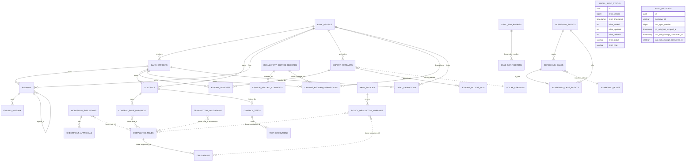

**Notes on the graph:**
- Single dashed edges = **loose string links** (no enforced FK). Used for
  cross-pipeline references (`rule_id`, `regulation_id`, `change_ref`,
  `obligation_id`, `sdn_number`) so partial syncs and per-cycle writes
  don't trigger FK violations.
- Solid edges = **enforced FK**. Used inside P2-native clusters
  (controls→tests, workflow→checkpoint, artifact→signoff, finding→history,
  case→case_events).
- `regulatory_change_records` is shared schema with P1, but P2 enriches it
  with `client_id`, `updated_at`, and the sign-off workflow columns.

---

## 7. Migration timeline (P2-specific)

| Mig | Tables touched | What it does |
|---|---|---|
| 016 | `workflow_executions`, `checkpoint_approvals` | Agent workflow orchestration core |
| 017 | `bank_policies`, `policy_regulation_mappings` | Policy gap matrix (Panel 6) |
| 020 | `regulatory_change_records` | `*_at` columns → `TIMESTAMPTZ` |
| 028 | `screening_events`, `screening_cases`, `screening_case_events` | OFAC case management + immutable audit log |
| 030 | `sync_metadata` | `p1_sdn_last_scraped_at` (SDN freshness cache) |
| 031 | `sync_metadata` | `last_sdn_change_consumed_at` + `_ref` (keyset cursor for /sync/sdn-changes) |
| 033 | `workflow_executions` | Partial unique index `uq_workflow_jira_story_inflight` (one-in-flight per story) |
| 034 | `screening_rules` | DB-backed inventory + seeds FUZZY-001 / CLEAN-001 / OWN50-001 / FRESH-001 |
| 035 | `screening_cases.matched_rule_id` | FK to `screening_rules` (ON DELETE SET NULL) |
| 037 | `regulatory_change_records.change_delta` | Per-record JSONB diff (frozen at detection) |
| 038 | `ofac_list_versions` | OFAC freshness anchor (used in attestation export) |
| 042 | 14 tables (bank_profile, bank_officers, controls, control_rule_mappings, control_tests, test_executions, findings, finding_history, change_record_dispositions, ofac_validations, export_artifacts, export_signoffs, export_access_log, vocab_versions) | Examination evidence & reports (M16) |

P1 migrations 007–023 + 037 still apply because P2 replicates those tables —
see [PIPELINE1_CCO_WALKTHROUGH.md §11](./PIPELINE1_CCO_WALKTHROUGH.md).

---

## 8. Auth, multi-tenancy, and runtime guardrails

| Question CCO will ask | Where the answer lives |
|---|---|
| "How do we keep one bank's data out of another bank's view?" | Per-bank ECS cluster, ALB, Aurora, and S3 export bucket. Each P2 deployment is fully isolated; only the regulatory plane (P1) is shared. SSM paths are namespaced `/fortress/{bank_id}/*`. |
| "How do users log in?" | Cognito hosted UI. JWT carries `cognito:groups`; P2 API resolves to one of {Analyst, CCO, CRO, Admin}. Dev token fallback fails closed when `ENVIRONMENT=production`. |
| "How do we prevent a runaway test from leaking secrets?" | Sandbox test runner inherits **only** PATH/LANG/LC_ALL/TERM/PYTHONUSERBASE; `PYTHONPATH` is intentionally excluded so generated tests can't `import src.api.sync_api`. HOME/TMPDIR forced to the per-run output dir so pytest's cache can't reach `~/.aws/credentials`. |
| "How do we prevent the dashboard from being scraped externally?" | CloudFront in front of S3 SPA + WAF on the API ALB. Per memory `project_p2_waf_blocklist`: priority-0 IPSet blocklist with XFF rule (because ALB sees CloudFront's IP, not the client). |
| "How do we know an artifact wasn't doctored?" | `export_artifacts.sha256` (bytes) + `snapshot_canonical_sha256` (input) + `vocab_version` + `template_version` + `app_commit`. S3 Object Lock COMPLIANCE prevents deletion until `object_lock_retain_until` (default NOW + 7 years). |
| "Can a runaway agent re-process the same JIRA story?" | No. Webhook dedup on completed run + partial unique index `uq_workflow_jira_story_inflight` keeps one in-flight; advisory lock `0x70327367` serialises Bedrock calls cluster-wide. |
| "Can we revoke a CCO mid-shift?" | Remove user from the Cognito group → next JWT refresh (≤1 h) loses the role. For immediate revocation, disable the Cognito user. |
| "Where does customer transaction data go?" | Nowhere outbound. All `validators.py` flows write a non-PII audit row to `transaction_validations` and screening_events. The only data that leaves P2 is the **telemetry** sent back to P1 via `/sync/status` (counts only, no PII). |

---

## 9. Where to look in the code

| Topic | File:line |
|---|---|
| Entry point (routers, lifespan, CORS) | `src/main_pipeline2.py:1–124` |
| 6 agents | `src/agents/{discovery, understanding, framework, generation_bedrock, validation, execution}.py` |
| Workflow orchestration | `src/orchestration/workflow_engine.py` |
| JIRA webhook (auth + dedup + lock) | `src/api/webhooks.py:1–150` |
| Checkpoint approvals | `src/api/approvals.py:1–87` |
| Validators (Wire / OFAC / Loan) | `src/services/validators.py` |
| Validation API (rate-limit + metrics) | `src/api/validation_api.py:1–150` |
| Screening API (dual auth + idempotency) | `src/api/screening_api.py:1–100` |
| Dashboard API | `src/api/dashboard_api.py:1–1000` |
| Exports API | `src/api/exports.py:74–150` |
| Exports worker (snapshot + canonical + render) | `src/exports/worker.py`, `snapshot.py`, `canonical.py`, `csv_writer.py` |
| UpdateService (P1 sync) | `src/services/update_service.py:1–1600` |
| ComplianceRuleResolver | `src/services/compliance_rule_resolver.py:121–577` |
| GitHub PR service | `src/services/github_service.py` |
| Sandbox test runner | `src/services/test_runner.py` |
| Cognito auth + RBAC | `src/api/auth.py:1–150` |
| Models (all P2 tables) | `src/models/database.py` |
| Migrations | `alembic/versions/` (016, 017, 020, 028, 030–031, 033–035, 037–038, 042) |
| Dashboard SPA | `dashboard/src/App.jsx`, `dashboard/src/pages/*` |
| Dashboard deploy | `dashboard/deploy.sh` |
| CloudFormation (P2) | `infra/cloudformation/pipeline2-{vpc,data,compute,security,dashboard,exports-worker,exports-bucket,exports-alarms,billing,ba-jump}.yml` |
