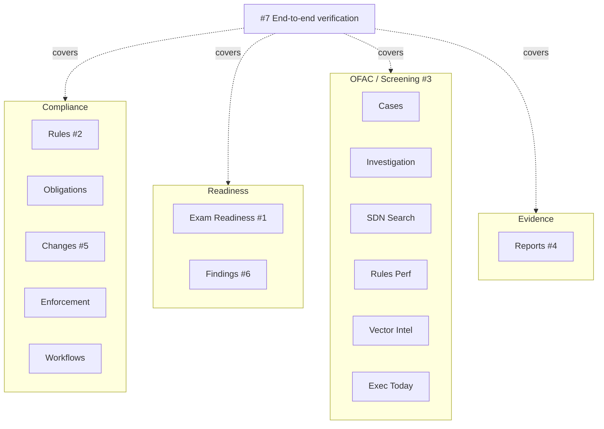
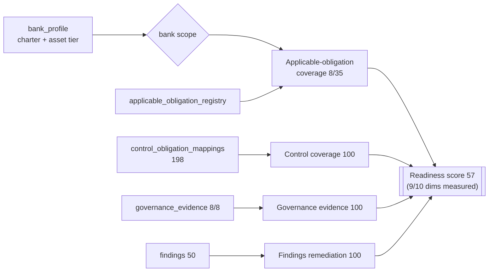
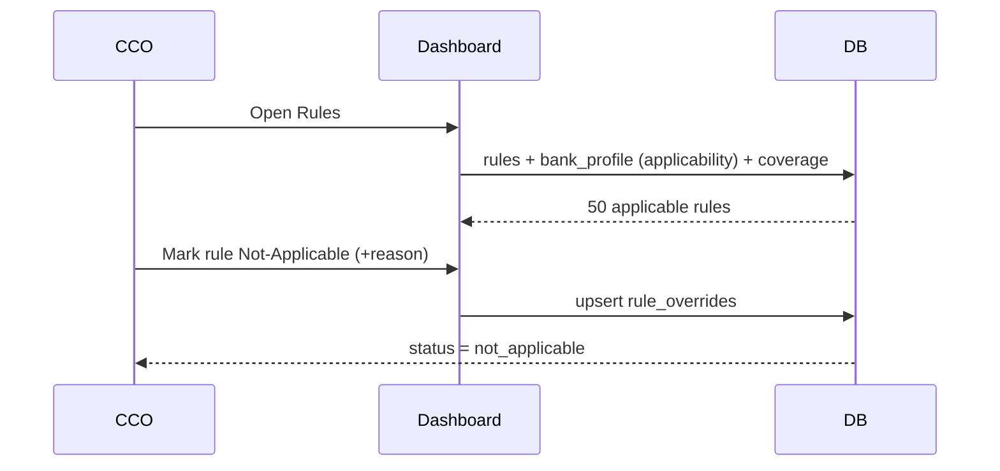
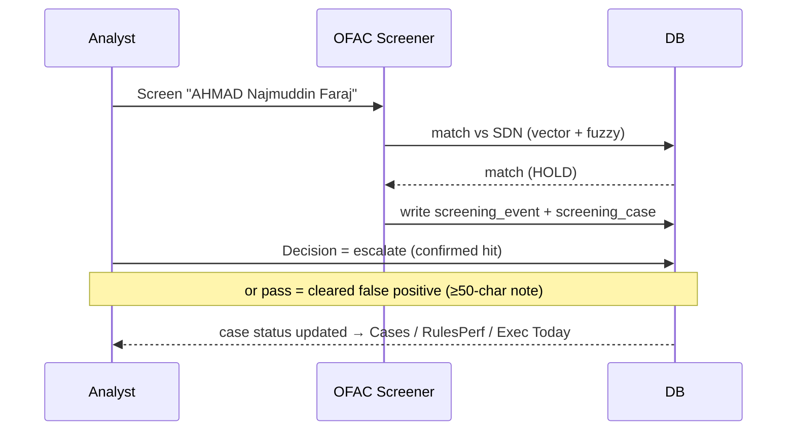
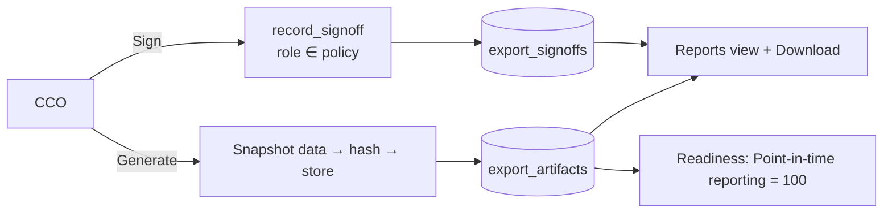
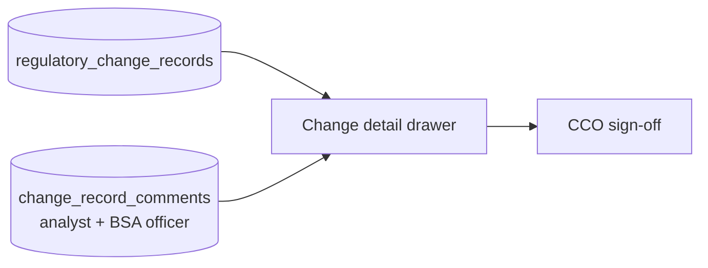
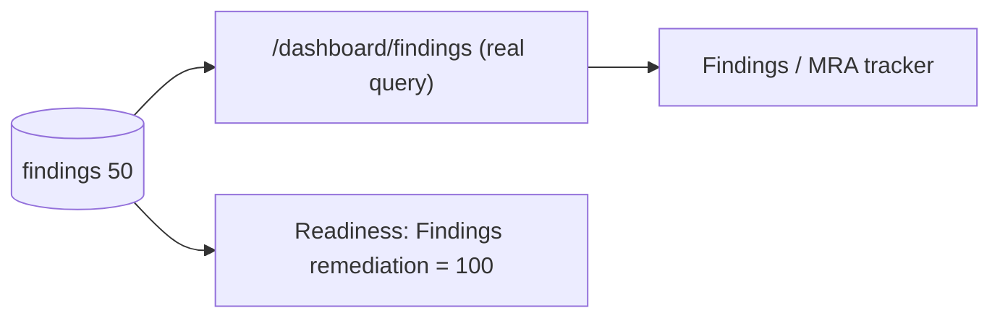
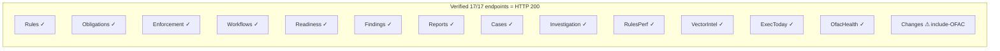

# Dashboard Completion — Business Analyst / SME Review

**Audience:** BSA/AML SME, Business Analyst, Compliance Officer.
**Purpose:** review the 7 completed dashboard work items — each as a **business
use case**, the problem, the fix, **what the SME should verify**, and a diagram.
**Scope:** local validation environment (bank id `testbank`); honest gaps are in
`completion_report.md`. Diagrams render on GitHub or any Mermaid viewer.

---

## How to read each item
Every section has: **Business use case** (why a CCO/analyst needs it) · **What
was wrong** · **The fix** · **SME verification** (steps you can check) · a
**diagram**.

## Overview — the 14 views and the 7 work items

---

## 1 · Exam Readiness — real posture, not placeholders

**Business use case.** Before a regulatory exam, the CCO needs a single
readiness score that honestly reflects the bank's BSA/AML posture across
obligation coverage, controls, governance evidence, findings, and testing — so
they know where the gaps are *before the examiner does*.

**What was wrong.** 4 of the scoring dimensions had no bank data, so the gauge
fell back to generic proxies or excluded them — the number wasn't trustworthy.

**The fix.** Populated the bank's real compliance data so the dimensions compute
in "registry" (real) mode:
- `bank_profile` (charter = national, asset tier = community) → scopes applicability
- `applicable_obligation_registry` (35 required CFRs) → *Applicable-obligation coverage*
- `control_obligation_mappings` (198 obligations mapped to controls) → *Control coverage*
- `governance_evidence` (all 8 board/committee/policy artifacts) → *Governance evidence*
- `findings` (50) → *Findings remediation*

Result: readiness **57 / "developing"**, 9 of 10 dimensions measured.

**SME verification.**
- Open **Exam Readiness** (CCO lens) → the score shows with per-dimension bars.
- Check *Applicable-obligation coverage* = 8 of 35 — i.e. our rule corpus covers 8 of the 35 CFRs a national/community bank must address (a real coverage gap, correctly surfaced).
- Confirm *Governance evidence* lists 8 of 8 canonical artifacts.

---

## 2 · Rules — scoped to *this* bank, with Not-Applicable

**Business use case.** The CCO works a list of BSA/AML rules ranked by severity
and enforcement risk, sees which already have test coverage, and can mark a rule
**Not Applicable** (with a documented reason) when it doesn't apply to the bank.

**What was wrong.** Applicability had no bank profile to scope against, and the
N/A path was unexercised.

**The fix.** Seeded `bank_profile`; applicability now resolves to the bank's
charter/asset tier. Exercised a mark-N/A → persisted to `rule_overrides` with
the CCO's reason.

**SME verification.**
- Open **Rules** → 50 rules listed, ranked by severity then risk.
- Mark one rule N/A with a reason → it persists and shows the override.

---

## 3 · OFAC Screening — search → case → decision

**Business use case.** An analyst screens a customer/counterparty name against
the OFAC SDN list, reviews matches, opens a case on a hit, and records a
disposition (confirmed hit → escalate; false positive → clear with notes). The
CCO sees case queues, rule performance, and a same-day board view.

**What was wrong.** The entire screening domain (6 views) was empty — no
screening rules, cases, or events.

**The fix.** Seeded the 4 `screening_rules`, ran 7 live screens (4 real SDN hits
→ HOLD cases, 3 clean), and recorded decisions (2 escalated, 1 cleared false
positive with documented rationale, 1 in review).

**SME verification.**
- **SDN Search** — screen "AHMAD Najmuddin Faraj" → HOLD with a match.
- **Cases** — 4 cases; **Investigation** — open one, see match detail + decision history.
- **Rules Performance** — alert volume / precision per screening rule.
- **Executive Today** — same-day tiles; **Vector Intel** (Admin/CRO) — embedding coverage.

---

## 4 · Reports — WORM-locked exam evidence, signed

**Business use case.** For an exam or board meeting, the CCO generates the six
canonical evidence packs (examiner package, OFAC attestation, board report, MRA
tracker, change log, coverage), has them signed by the required officers, and
downloads tamper-evident copies.

**What was wrong.** Generation required cloud storage/KMS and a worker that
aren't present locally, so the Reports view stayed empty.

**The fix.** Added a local-storage fallback so artifacts generate on the local
filesystem (production still uses the S3 WORM path unchanged). Generated all 6,
signed each (CCO for 5, BSA Officer for the OFAC attestation), confirmed download.

**SME verification.**
- Open **Reports** → 6 artifacts listed with generated/signed status.
- Download one (e.g. *coverage*) → a CSV evidence file.
- Confirm single-signer reports show **fully signed**; the two dual-signer
  "strong" reports show 1 of 2 required signers.

---

## 5 · Changes — review drawer with discussion history

**Business use case.** When a regulatory change is detected, the CCO opens its
detail drawer to see the per-record diff and the analyst discussion before
signing off.

**What was wrong.** The detail drawer had no comment history.

**The fix.** Seeded `change_record_comments` (analyst + BSA-officer notes) on
change records; the drawer now shows the thread.

**SME verification.**
- Open **Changes**, toggle *Include OFAC* (the only change records locally are
  the OFAC SDN feed) → records list.
- Open a record → the drawer shows the comment thread.

> Honest note: there are **no non-OFAC rule changes** locally, so the default
> inbox (which hides OFAC) is empty until the production rule-change detector runs.

---

## 6 · Findings / MRA tracker — reads the real table

**Business use case.** The CCO tracks findings and Matters Requiring Attention
(MRAs): what's open, overdue, and remediated — the evidence an examiner asks for.

**What was wrong.** The Findings endpoint was a placeholder that always returned
an empty list, even though a findings table existed.

**The fix.** Replaced the stub with a real query over the `findings` table
(scoped to the bank, open items first, overdue counted).

**SME verification.**
- Open **Findings** → 50 findings with status; 0 overdue (all remediated in the seed).
- Cross-check: the readiness *Findings remediation* dimension = 100 from the same table.

---

## 7 · End-to-end verification — assurance all views work

**Business use case.** Before handing the dashboard to the CCO, confirm every
view actually loads real data (not a half-wired demo).

**What was done.** Probed all 17 dashboard endpoints with the correct roles.
Result: **17/17 HTTP 200**, **13/14 views show data by default**; Changes shows
data with *Include OFAC* on.

**SME verification.** Spot-check any view from §§1–6; each returns data.

---

## Honest gaps (for SME awareness — not defects, not faked)
| Area | State | Needs |
|---|---|---|
| **Risk-assessment currency** / Risk view | thin (score 0) | P1 to extract which CFRs each enforcement action cited (`enforcement_actions.regulations_cited` is empty) — **not fabricated** |
| **Changes** default inbox | empty | P1 rule-change detector to produce non-OFAC change records |
| **Substantive test correctness** | unverified | SME golden-set: rules with officer-reviewed *expected* assertions |

See `completion_report.md` for the full status and `docs/design/dashboard-data-map.md`
for which tables feed each view.
