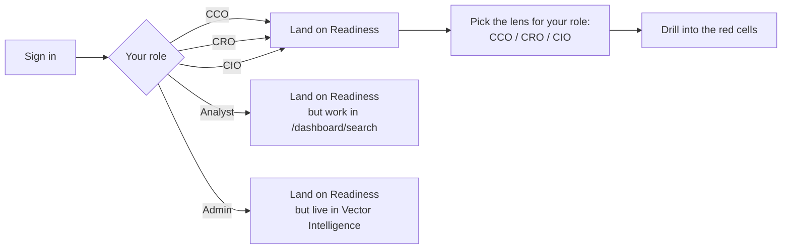
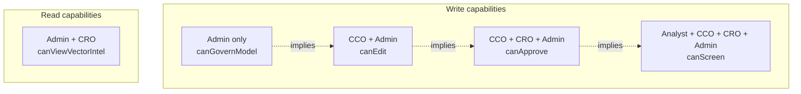
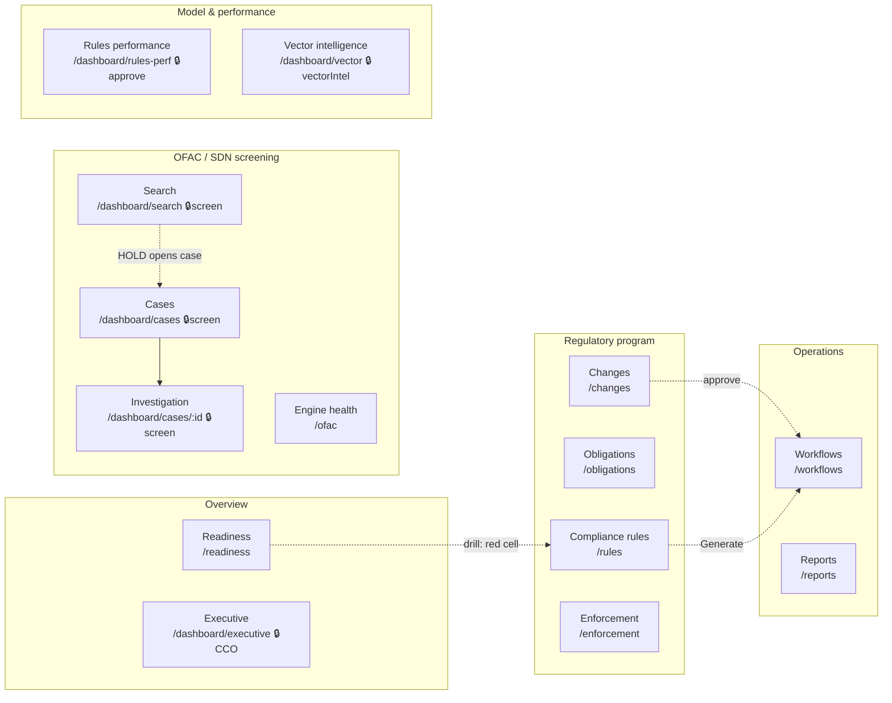
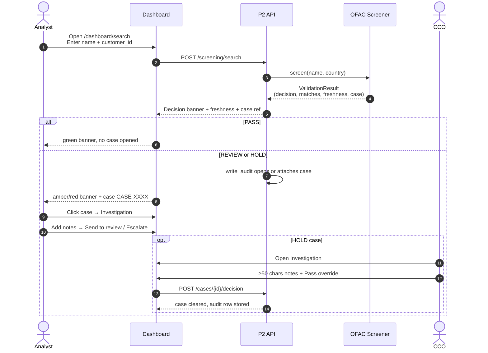
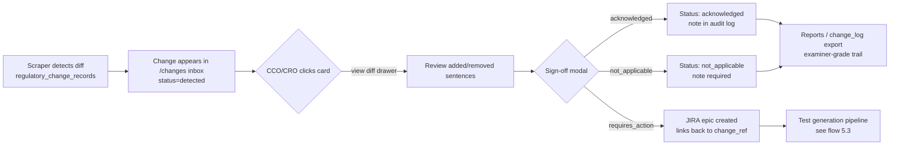
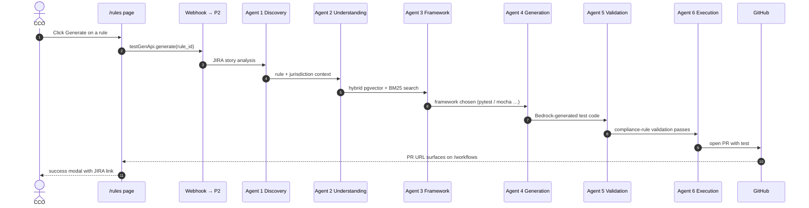
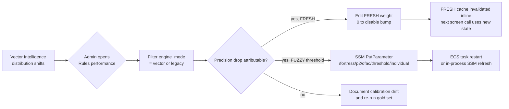

# Fortress Dashboard — Customer Onboarding Guide

**Audience:** Anyone at the bank who will use the dashboard — CCO, CRO, CIO, Analysts, Admins, and the IT lead who will provision them.
**Reading time:** 25 minutes end-to-end. The "Quick start" section below is 5.
**Goal of this document:** You can read this and be productive without anyone walking you through it.

---

## 1. Quick start

The dashboard has **5 navigation groups** and **14 tabs**. Each tab is owned by one role and supports up to four others in a read-only or assist capacity.

**Where to start on day one, by role:**

| Role | First page to open | What you're doing |
|---|---|---|
| **CCO** | Readiness → CCO lens | Read the score, fix the biggest drag |
| **CRO** | Readiness → CRO lens | Compare residual risk vs. appetite |
| **CIO** | Readiness → CIO lens | Confirm pipeline + data-residency posture |
| **Analyst** | `/dashboard/search` | Screen your first party |
| **Admin** | `/dashboard/vector` | Sanity-check embedding coverage |

The rest of this doc walks every tab, every stat, every workflow.

---

## 2. Roles and what each one can do

Five roles. Your AWS Cognito group at sign-in determines which one you get.

**Capability matrix** (from `dashboard/src/App.jsx`):

| Action | CCO | CRO | CIO | Analyst | Admin |
|---|:-:|:-:|:-:|:-:|:-:|
| View Readiness / Rules / Obligations / Changes / Enforcement / OFAC Health / Workflows | ✓ | ✓ | ✓ | ✓ | ✓ |
| Screen parties; open & decide SDN cases | ✓ | ✓ | | ✓ | ✓ |
| Sign off regulatory changes | ✓ | ✓ | | | ✓ |
| Generate exam exports (PDF/CSV) | ✓ | ✓ | | | ✓ |
| View Rules Performance | ✓ | ✓ | | | ✓ |
| Generate tests · mark rule N/A · Pass-override a HOLD case | ✓ | | | | ✓ |
| View Executive Today (board view) | ✓ | | | | |
| View Vector Intelligence | | ✓ (read) | | | ✓ |
| Edit screening rule weights / activation (G1) · tune thresholds | | | | | ✓ |

**Practical rule of thumb:**
- If a button is greyed out, your role isn't the right escalation path. Ask the appropriate owner.
- Every write action is captured in the audit log with your email — that's the point of role separation.

---

## 3. Navigation map

🔒 means the item is hidden in the sidebar unless you have the capability — `canScreen`, `canApprove`, `canEdit` (CCO), `canViewVectorIntel`.

---

## 4. Page-by-page reference

Each section below covers **one tab** with the same structure: route, owner, every stat displayed, the actions you can take, common pitfalls.

---

### 4.1 Readiness — the home screen

| Field | Value |
|---|---|
| Route | `/readiness` |
| Backend | `GET /api/v1/dashboard/readiness?lens={cco|cro|cio}` + `risk-matrix`, `cro`, `cio`, `findings` |
| Owner | CCO (CRO and CIO get their own lens) |
| Visible to | Everyone |
| Source: `dashboard/src/pages/Readiness.jsx` |

**What you see — top section ("Hero")**
- **Readiness gauge** — single 0–100 score, color-banded:
  - `failing` < 50 (red), `developing` 50–69 (amber), `operational`/`strong` ≥ 70 (green)
- **Biggest drag** — one-line plain-English headline (e.g. "15 obligations are not mapped to a control")
- **Risk × coverage matrix** — 3 risk rows (High/Med/Low) × 3 coverage cols (Untested/Partial/Tested). Cells:
  - Red ("danger") = High × Untested — examiner's first finding
  - Amber ("warn") = High OR Untested but not both
  - Green ("ok") = Tested anything
  - Click any non-zero cell → drills to `/rules?ids=…` filtered to those rule IDs

**What you see — Dimensions**
A horizontal bar for each of the 10 readiness pillars, scored 0–100. Color: ≥70 green, 50–69 amber, <50 red. Pillars are sorted **lowest-first** so the worst one is on top.

**What you see — lens-specific panels**

CCO lens — Coverage & evidence:
- Obligation inventory %
- Control mapping %
- Tested obligations %
- Change management %
- Governance evidence %
- Open findings (MRAs) list

CRO lens — Residual risk vs. appetite by domain (Sanctions/OFAC, BSA/AML, Consumer, Privacy, State licensing) + Key Risk Indicators (90-day trend, ▲/▼) + Peer signal from enforcement actions.

CIO lens — Pipeline success rate (7d), avg duration, embedding integrity, uptime, open failures + Architecture rows (deployment model, customer data residency, connector health, RBAC + audit immutability).

**How to use**
1. On open, your role's lens loads by default — toggle to compare.
2. Identify the lowest dimension bar → click the related operating tab (Rules / Obligations / OFAC / Workflows).
3. Click red cells in the matrix → land on the Rules page filtered to those rule IDs → fix them.

**Pitfalls**
- "Could not load readiness score" usually means the backend can't reach the database — flag to the CIO; don't take action.
- The matrix counts attached rules at the moment you load it; refresh after sign-off to re-score.

---

### 4.2 Executive Today — CCO board view

| Field | Value |
|---|---|
| Route | `/dashboard/executive` |
| Backend | `GET /api/v1/dashboard/screening/executive-today` |
| Owner | **CCO only** (gated on `canEdit`) |
| Source: `dashboard/src/pages/ExecutiveToday.jsx` |

**What you see**
- A row of "tiles" — labels come from the backend (e.g. *Screened today*, *Holds*); each value is a single number.
- **SDN list freshness** — colored dot + "updated N hours ago" + the OFAC SLA reminder ("within 24h of source publication").

**How to use** — Open this when prepping a board / examination meeting. It's the only page that intentionally hides the technical detail.

**Pitfalls** — If "freshness" reads "unknown", the OFAC sync ran too long ago — escalate to the CIO. Don't take a daily attestation off a stale dashboard.

---

### 4.3 Compliance rules

| Field | Value |
|---|---|
| Route | `/rules` (optionally `?ids=…` from Readiness matrix drill) |
| Backend | `GET /api/v1/dashboard/rules` |
| Owner | **CCO** (write); everyone else reads |
| Source: `dashboard/src/pages/Rules.jsx` |

**What you see**
Pageable table (100/page) with:
- **Rule ID** — e.g. `OCC-BSA-WIRE-001`, `CA-DFPI-…`
- **Regulator** chip — FinCEN / OCC / CFPB / FDIC / OFAC / FFIEC / state DFIs
- **CFR citation**
- **Obligation** snippet (140 chars of rule text)
- **Risk** — `enforcement_risk_score` (0–1, formatted to 2 dp). Bucketed `hi ≥ 0.8`, `md ≥ 0.6`, `lo` below
- **Status** — Tested · Not tested · Excluded (when bank marked N/A)

Filter chips on Jurisdiction (All / Federal / State, regex on `^(CA|TX|FL|NY|WA)-`) and Regulator.

**Actions (CCO + Admin only)**
- **Generate ↗ / Regenerate** — opens a modal; optional bank-specific threshold override; "Create JIRA story" triggers the 6-agent pipeline; success returns a JIRA URL.
- **N/A** — opens a modal; reason text is required (audit trail) → sets `bank_status = not_applicable`.

**How to use**
1. Filter to the regulator/jurisdiction you own.
2. Sort mentally by risk — High (red) without "Tested" is what an examiner picks first.
3. Click Generate → JIRA story → 6-agent pipeline runs → eventually a GitHub PR opens with the test.

**Pitfalls**
- "Generate" requires CCO. "Mark N/A" is permanent until you flip it back via SQL — the dashboard doesn't expose un-N/A.
- The risk score is computed from enforcement actions; if it's "—" the score isn't seeded yet.

---

### 4.4 Obligations

| Field | Value |
|---|---|
| Route | `/obligations` |
| Backend | `GET /api/v1/dashboard/obligations` |
| Owner | CCO |
| Source: `dashboard/src/pages/Obligations.jsx` |

**What you see**
- 3 KPI tiles: **Total obligations** · **With test coverage** (+ coverage %) · **Awaiting tests** (queued for generation)
- **By regulator** — a horizontal bar per regulator showing how many obligations are attributed to it. The doc-line emphasizes "no unknown bucket" — every obligation must attribute, by intake design.

**How to use** — Use this when an examiner asks "show me your inventory by regulator." The "Awaiting tests" tile is your generation backlog target.

**Pitfalls** — If the page shows "No obligations extracted yet," the obligation extractor hasn't run for any rule on this bank — escalate to CIO.

---

### 4.5 Regulatory change inbox

| Field | Value |
|---|---|
| Route | `/changes` |
| Backend | `GET /api/v1/dashboard/changes` + `/changes/{ref}` + `POST /changes/{ref}/signoff` |
| Owner | **CCO or CRO** signs off; everyone reads |
| Source: `dashboard/src/pages/Changes.jsx` |

**What you see**
- Header: "Regulatory change inbox · N unsigned"
- Paginated list (20/page) of change cards. Each card:
  - Severity chip — high (red), medium (amber), low (green) — from `impact_rating`
  - Regulator badge + rule_id badge + status (`detected`, `acknowledged`, `requires_action`, `not_applicable`)
  - Change summary (truncated 120 chars)
  - Semantic diff snippet (240 chars)
  - Change ref · date · "view diff" link
- **Sign-off button** appears only on cards with status=`detected` AND user has `canApprove`.
- Clicking the body of any card opens a **drawer** with the full diff: added sentences (green), removed sentences (red strikethrough), current rule text, previous rule text, CFR citation, source URL.

**Sign-off modal**
- Disposition (required): `acknowledged` / `requires_action` (creates a JIRA epic) / `not_applicable`
- Note (optional but recommended for audit trail)
- Toast confirms success or surfaces backend errors with HTTP status

**How to use**
1. Sort by severity in your head — work `high` first.
2. Click into each card → review the diff.
3. Disposition → `requires_action` if the rule needs a new test; the system creates a JIRA epic linking to the change ref.

**Pitfalls**
- Don't bulk-acknowledge — examiners look at the timestamp distribution. A burst of identical acknowledgements two days before exam looks bad.
- Re-running the OFAC SDN refresh creates a flood of cosmetic changes. Use the OFAC exclusion checkbox on the inbox query (`include_ofac=false`) — it's the default.

---

### 4.6 Enforcement actions

| Field | Value |
|---|---|
| Route | `/enforcement` |
| Backend | `GET /api/v1/dashboard/enforcement?regulator=&page=&page_size=` |
| Owner | **CRO** (leading indicator for risk appetite) |
| Source: `dashboard/src/pages/Enforcement.jsx` |

**What you see**
- Pageable table (25/page). Columns: Date · Regulator · Action type · Institution · Summary · Penalty.
- Filter chips: All / OCC / CFPB / FinCEN / OFAC / FDIC.
- Penalty figures above **$10 B** are rendered with a "held for review" flag — that's the parser's sanity guard against bad OCR/dollar-amount extraction.
- Action types are humanized: `consent_order` → "Consent Order", etc.

**How to use** — CRO scans this monthly to update peer-enforcement signal. If a peer was fined recently in your domain, expect heightened scrutiny.

**Pitfalls** — Don't action on "held for review" penalties without manual verification of the source URL. The parser is conservative-by-design.

---

### 4.7 OFAC / SDN engine health

| Field | Value |
|---|---|
| Route | `/ofac` |
| Backend | `GET /api/v1/dashboard/ofac-health` |
| Owner | **CIO** (engine integrity); CCO reads for attestations |
| Source: `dashboard/src/pages/OfacHealth.jsx` |

**What you see**
- **Header strip** — green when fresh, amber/red when staleness > 24 hours. "updated N hours ago · within 24h SLA"
- 3 capability cards: **Complete** (counts) · **Evasion-resistant** (typo/transliteration coverage) · **Current** (within-24h refresh)
- **Technical details** collapsible — SDN entries, name variants, embeddings count + %, retrieval algorithm (HNSW + trgm + tsv), deployment ("in-VPC (customer)")
- **Screening controls table** — the 4 canonical OFAC rules: FUZZY-001 (≥92%), CLEAN-001 (no FP), OWN50-001 (≥50% ownership), FRESH-001 (<24h)

**How to use** — CIO opens this weekly to confirm refresh is meeting SLA. CCO attaches a screenshot of this page to the monthly OFAC attestation.

**Pitfalls**
- If `vector_mode_ready=false`, ANN ("Vector Similarity") returns 0 results until embeddings finish. The trgm + tsv paths still serve full coverage; *no screening gap*.
- "Stale" header means SDN > 24 h old → CIO must investigate the sync job.

---

### 4.8 SDN Search — front-line screening

| Field | Value |
|---|---|
| Route | `/dashboard/search` |
| Backend | `POST /api/v1/dashboard/screening/search` |
| Owner | **Analyst** (CCO/CRO/Admin can also screen) |
| Source: `dashboard/src/pages/SdnSearch.jsx` |

**What you see**
- Search form: Name (required) · Country ISO-2 · Date of birth · Customer ID (optional)
- After submit:
  - **Decision banner** — PASS (green) / REVIEW (amber) / HOLD (red) + Final Risk Score (0–100) + screening id (first 8 chars)
  - **Freshness line (D5)** — "SDN list refreshed *N* h ago" + "Decision bumped one level because data is stale" *or* "Within freshness window — no staleness bump"
  - **Attached-case line (G4)** — when a screening lands on a party with an open case for the same `external_customer_id + sdn_number`, "Attached to existing case CASE-XXXX (opened …)" — tells you any decision applies to *that* case, not a fresh one
  - **Match table** — SDN · Matched name · Programs · Country · Fuzzy / Alias / Vector / Final scores (all 0–100)
  - **Action buttons** — Pass (CCO only) / Send to review / Escalate (last two for any Analyst+)

**How to use**
1. Type a party name → Screen.
2. **PASS** with no matches → party clears, no case opens.
3. **REVIEW / HOLD** → a case opens automatically; click "case CASE-…" to jump to investigation, or use the action buttons.
4. The **Pass** button on the search panel is intentionally narrow: it requires CCO and only proceeds if a case has actually been opened (`result.case_id` present).

**Pitfalls**
- Two searches on the same `customer_id + sdn` within 24 h attach to the *same* open case. The "Attached to existing case" line is there so you don't think you're opening a new one.
- A REVIEW with stale data + the FRESH rule weighted >0 → engine auto-bumps to HOLD. The freshness line tells you that's *why* the decision is high.
- Idempotency: the same canonical criteria within 24 h returns a verbatim replay with `X-Idempotent: true` — that's by design, not a bug.

---

### 4.9 Screening cases queue

| Field | Value |
|---|---|
| Route | `/dashboard/cases?status=&priority=&q=` |
| Backend | `GET /api/v1/dashboard/screening/cases` |
| Owner | **Analyst** (lives here all day) |
| Source: `dashboard/src/pages/Cases.jsx` |

**What you see**
Filter row: Status (Open / Closed / All) · Priority (Any / High / Medium) · Free-text search across name / SDN / customer · "N total" count.

Table columns:
- **Case** (clickable link to Investigation)
- **Priority** chip — `high` = red, `medium` = amber
- **Decision** at open — PASS / REVIEW / HOLD chip
- **Matched** name
- **SDN** number
- **Customer ID**
- **Events** — how many screenings have attached to this case
- **Status** — open / cleared / closed
- **Opened** — date+time

**How to use**
1. Default filter is `status=open` — that's your work queue.
2. Click the case ID → Investigation page.
3. URL params are sharable — drop one in a chat to escalate to a colleague.

**Pitfalls** — If the queue is huge, sort priority=`high` first. Confirmed-true-positives that get re-attached on a recurring monitoring screen will bump event counts — that's the SDN program working, not a duplicate.

---

### 4.10 Investigation — single-case page

| Field | Value |
|---|---|
| Route | `/dashboard/cases/:caseId` |
| Backend | `GET /api/v1/dashboard/screening/cases/{id}` + `POST /cases/{id}/decision` |
| Owner | **Analyst** records review-or-escalate; **CCO** clears with Pass override |
| Source: `dashboard/src/pages/Investigation.jsx` |

**What you see**
Header row: priority chip · decision-at-open chip · customer ID · SDN number · event count · status.

Then three panels:
1. **Score breakdown — latest screening**: Fuzzy Match · Alias Match · Vector Similarity · Final Risk Score (all 0–100).
2. **Matched entity**: Name · Type · Country · Nationality · Programs · Aliases (first 5) · Remarks.
3. **Decision history**: timestamp · actor · decision · score · engine_mode · party_name for every screening that has attached.

**Decision panel** (only shows if case is not yet `cleared`/`closed`):
- Notes textarea — placeholder changes if the case was opened as HOLD ("Reviewer notes — required (≥50 chars) to Pass a HOLD")
- **Pass** (CCO only) — disabled until ≥50 chars of notes if `decision_at_open=HOLD` (G3 guardrail)
- **Send to review** — any Analyst+
- **Escalate** (red) — any Analyst+
- Footer: "Signing as <your email>"

If the case has already been resolved, you see who closed it, when, and the notes left behind.

**How to use**
1. Read the score breakdown — is the final score above the HOLD threshold (0.92)?
2. Read the entity panel — does the country / programs / aliases support a true positive or a coincidence?
3. Record a decision *with notes* — that's the audit trail an examiner asks for.

**Pitfalls**
- HOLD→Pass with notes < 50 chars is blocked both client- and server-side (`PASS_HOLD_MIN_NOTES_CHARS`). Don't try to bypass — leave a proper rationale or escalate.
- "Pass (CCO override)" is intentionally the strictest button: the case opened as HOLD because the engine thinks it's a real match. Document why you disagree.

---

### 4.11 Rules performance

| Field | Value |
|---|---|
| Route | `/dashboard/rules-perf?engine_mode=` |
| Backend | `GET /api/v1/dashboard/screening/rules-perf` + `PATCH /screening/rules/{id}` (G1 admin) |
| Owner | **CCO/CRO** read; **Admin** edits weights/activation |
| Source: `dashboard/src/pages/RulesPerf.jsx` |

**What you see**
- **Engine-mode selector** (G6) — All · Legacy (SequenceMatcher) · Vector (pgvector + trgm). Filters all stats below by the engine that opened each case. Useful during the legacy→vector A/B so engine-driven precision swings don't get blamed on a rule.
- 5 KPI tiles: Alerts (lifetime) · True positives (+%) · False positives (+%) · Open · Precision (= tp / (tp + fp), rounded 3 dp).
- **Rule inventory** table — Rule · Name · Policy weight · Description · Status (active/inactive) · Action.
  - Policy weight is *display-only* for FUZZY/OWN50/CLEAN (scoring is governed by `OFAC_HOLD_THRESHOLD = 0.92` + per-class SSM thresholds at `/fortress/p2/ofac/threshold/*`).
  - FRESH weight is *engine-active* — > 0 enables the staleness bump, ≤ 0 disables it.
- **Edit button** (Admin only) — opens a modal with weight (0–10), is_active checkbox, description (1–1000 chars). Save bumps `version` and stamps `updated_by` with your email.
- **Alert volume by opening decision** — counts of cases opened at each decision level.

**How to use**
1. CCO/CRO: monitor precision; if it drops, switch the engine-mode filter to see whether vector or legacy is dragging.
2. Admin: edit the FRESH weight to 0 to temporarily disable the staleness bump if SDN sync is broken and you don't want false HOLDs. (Re-enable when sync is healthy.)
3. Saves are immediate — the FRESH cache invalidates inline so the engine sees the change on the very next screen call.

**Pitfalls**
- Editing FUZZY/OWN50/CLEAN weight has *no engine effect* — those are display-only. The "policy weight" label and sub-header spell that out.
- Changing the description blanks audit symmetry; don't set it to `""` (server rejects with 422).

---

### 4.12 Vector intelligence

| Field | Value |
|---|---|
| Route | `/dashboard/vector` |
| Backend | `GET /api/v1/dashboard/screening/vector-intel` |
| Owner | **Admin** (write); **CRO** (read) |
| Source: `dashboard/src/pages/VectorIntel.jsx` |

**What you see**
- 2 KPI tiles: **Active SDN variants** · **Embedded variants** (+ coverage %).
- **Final score distribution — last 30 days (matches only)** — buckets (0.0–0.1 … 0.9–1.0) with hit counts. This is the only page where raw cosine scores are exposed by design.
- **Top screened names with matches — last 30 days** — party name · hits · avg final score.
- **Engine mode — last 7 days** — calls per mode (legacy / vector).

**How to use** — Admin uses the distribution chart to know if thresholds are calibrated. CRO uses it as model-governance evidence for the board.

**Pitfalls**
- If embedding coverage % is low, vector-mode screening will miss matches. Either wait for the embedding backfill to complete or flip to legacy mode via `OFAC_SCREENER_MODE` SSM.
- The Top variants list contains PII — treat the page accordingly. The page itself is gated to Admin/CRO.

---

### 4.13 Workflows — JIRA pipeline runs

| Field | Value |
|---|---|
| Route | `/workflows` |
| Backend | `GET /api/v1/dashboard/workflows` |
| Owner | **CIO** monitors; CCO sees PRs |
| Source: `dashboard/src/pages/Workflows.jsx` |

**What you see**
- 3 KPI tiles: **Success rate (7d)** (≥70 green, ≥40 amber, <40 red) · **Avg duration** (intake → PR opened) · **Open failures** (red if > 0).
- Table: JIRA story key · Status (Pending / Running / Awaiting / Completed / Failed) · Started time · Duration · Reason/Result (clickable PR link if there is one; otherwise failure reason).

**How to use**
1. Watch success rate; sustained < 70 % is a pipeline regression.
2. Click "View PR ↗" on a completed run to land on the GitHub PR with the generated test code.
3. Failures display the failure reason inline — read it before retrying.

**Pitfalls** — A "running" workflow that doesn't move for > 10 min is usually a 6-agent step waiting on Bedrock / GitHub. Check the runbook before clicking retry.

---

### 4.14 Reports

| Field | Value |
|---|---|
| Route | `/reports` |
| Backend | `POST /api/v1/dashboard/exports` + `GET /exports/{id}/download` |
| Owner | **CCO/CRO** generate; everyone reads |
| Source: `dashboard/src/pages/Reports.jsx` |

**What you see**
- "Generate as of" date picker + version-hash stamp (`v.<hash>`).
- 6 export tiles:
  - **Examiner evidence package** (PDF/CSV) — required
  - **OFAC screening attestation** (PDF/CSV) — required
  - **Board / audit-committee report** (PDF) — quarterly
  - **Findings / MRA remediation** tracker (PDF/CSV)
  - **Regulatory change log** (PDF/CSV)
  - **Coverage gap report** (PDF/CSV)

Each tile has a description, a tag chip, and per-format buttons. PDF opens a print dialog; CSV downloads as a file. Each export is stamped point-in-time with a version hash an examiner can verify.

**How to use**
1. Pick "as of" date (yesterday for monthly; quarter-end for board).
2. Click the format button on the tile you need.
3. Wait for the button to stop showing `…` — large exports take 10–30 s.

**Pitfalls** — A non-CCO/CRO user sees an amber strip "View-only role — exports require CCO or CRO permissions." Don't ask for elevated access; request the report from the right person.

---

## 5. End-to-end workflows

### 5.1 SDN screening (Analyst → CCO)

### 5.2 Regulatory change inbox (Detection → Evidence)

### 5.3 Test generation — 6-agent pipeline

### 5.4 Threshold tuning (Admin + CCO governance)

---

## 6. Onboarding checklist

### Day 1 — IT lead provisions users
- [ ] Create Cognito users in the per-bank pool (`us-east-1_…` in CFN stack `fortress-p2-dashboard-<bank>`)
- [ ] Assign each user to exactly one group: `CCO`, `CRO`, `CIO`, `Analyst`, `Admin`
- [ ] Send the user the dashboard URL (Cognito hosted UI redirects them to it after first sign-in)
- [ ] Confirm the user can sign in and lands on `/readiness`

### Week 1 — every named user
- [ ] CCO: open Readiness · pick lens · click into the lowest dimension · take one corrective action
- [ ] CRO: open Enforcement · skim the last month · open Readiness CRO lens
- [ ] CIO: open OFAC Health · check sync freshness · open Workflows · confirm pipeline success rate ≥ 70 %
- [ ] Analyst: do a dry-run SDN search on a non-real name · find your screening_id in the response · open the case (if any) and walk through the review buttons
- [ ] Admin: open Vector Intelligence · confirm embedding coverage ≥ 95 % · open Rules performance · do *not* edit weights yet

### Week 2 — steady state
- [ ] CCO: sign off every detected change (no bulk-ack); generate the Examiner evidence package as a dry run
- [ ] CRO: write a one-page note from the CRO lens (residual vs. appetite) for board
- [ ] Analyst: clear the open case queue daily; route any HOLD case > 24 h old to CCO
- [ ] Admin: only when calibration runbook says so, edit a threshold

### Ongoing
- Monthly: regenerate the OFAC attestation, attach to the program file
- Quarterly: Board / audit-committee report from the Reports page
- Before exam: pull every "Required" report on the same as-of date so version hashes line up

---

## 7. Glossary

| Term | Meaning |
|---|---|
| **Readiness score** | 0–100 composite of 10 dimensions; bands: failing < 50, developing 50–69, operational/strong ≥ 70 |
| **Decision** | PASS / REVIEW / HOLD — the screening engine's verdict on a party |
| **HOLD threshold** | `OFAC_HOLD_THRESHOLD = 0.92` — final score ≥ this opens a HOLD case |
| **Final score** | Hybrid of fuzzy + alias + vector similarities, 0–1, displayed as 0–100 |
| **Engine mode** | `legacy` (in-memory SequenceMatcher) vs. `vector` (pgvector ANN + trgm + tsv); chosen by `OFAC_SCREENER_MODE` SSM |
| **Staleness bump** | If SDN data > 24 h old AND the FRESH rule weight > 0, engine bumps decision one level (REVIEW→HOLD) |
| **Attached case** | A screening that lands on a party with an open `(customer_id, sdn_number)` case adds an event to that case rather than opening a new one |
| **6-agent pipeline** | Discovery → Understanding → Framework → Generation (Bedrock) → Validation → Execution → opens a GitHub PR |
| **MRA** | Matter Requiring Attention — examiner finding |
| **Sign-off** | A CCO/CRO disposition (`acknowledged` / `requires_action` / `not_applicable`) on a detected regulatory change |
| **Version hash** | Stamp on every exported report so the as-of state can be proven later |
| **Policy weight** | Display-only weight on a screening rule — does not affect scoring (FRESH excepted) |

---

## 8. Where to read more

- `docs/guides/dashboard-user-guide.md` — long-form reference (this doc's parent)
- `docs/guides/dashboard-roles-guide.md` — detailed role expectations
- `docs/dashboardscreening.md` — engineering deep-dive on the SDN screening surface
- `docs/runbooks/ofac-calibration-gold-set.md` — Admin runbook for threshold tuning
- `docs/runbooks/demo-readiness.md` — what an exam dry-run looks like
- `src/api/dashboard_api.py` — backend source of truth for every endpoint cited above

If a number on a tab disagrees with this guide, the **code is right and the guide is wrong** — open a doc fix.
