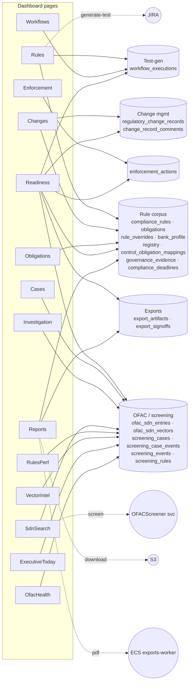
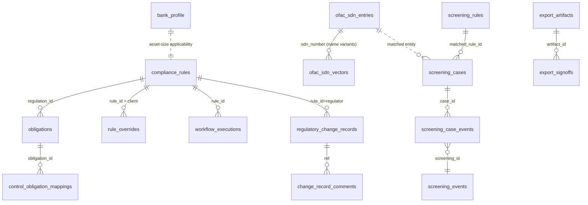

# Dashboard Use-Case → Data Map (P2 CCO Dashboard)

Every dashboard page, the API endpoint behind it, the Postgres tables it reads,
and the aggregate it shows — sourced from the actual SQL in `dashboard_api.py`,
`screening_api.py`, `exports.py` and the page components. Diagrams render on
GitHub / any Mermaid viewer.

---

## 1. Data-flow at a glance (pages → table clusters → external services)

The dashboard splits into **four domains**: Compliance management (Rules,
Changes, Obligations, Enforcement), **Exam readiness** (Readiness — the widest
consumer, touches six clusters), **OFAC/Screening** (Cases, Investigation,
SdnSearch, RulesPerf, VectorIntel, ExecutiveToday, OfacHealth), and
**Exports/Evidence** (Reports).

---

## 2. Core table relationships (ER)

*(Relationships are logical join paths used by the dashboard queries — several
are app-level joins on `rule_id`/`regulation_id`, not all FK-enforced.)*

---

## 3. Per-use-case detail

| Page | Shows | Endpoint(s) | Tables read | Aggregation |
|---|---|---|---|---|
| **Rules** | Applicable rules ranked by severity+risk, with test coverage; generate-test & mark-N/A | `GET /dashboard/rules`, `PATCH /dashboard/rules/{id}/status`, `POST /rules/{id}/generate-test` | `compliance_rules`, `rule_overrides`, `bank_profile`, `workflow_executions` (+JIRA on generate) | LEFT JOIN overrides per bank; asset-size applicability vs bank_profile; join workflow_executions for test_count; order by severity rank + risk |
| **Changes** | Regulatory-change inbox, aging buckets, diff drawer, single/bulk sign-off | `GET /dashboard/changes`, `GET /changes/{ref}`, `POST /changes/{ref}/signoff`, `POST /changes/signoff/bulk` | `regulatory_change_records` (+`compliance_rules`,`change_record_comments` on detail) | COUNT FILTER age buckets (fresh<7d / aging / overdue≥30d); detail joins rule + comments; signoff writes status |
| **Obligations** | Obligations by regulator with test-coverage % | `GET /dashboard/obligations` | `obligations` | GROUP BY regulator → total/covered/coverage_pct; top 1000 items |
| **Enforcement** | Peer enforcement actions, penalties, regulator filter | `GET /dashboard/enforcement` | `enforcement_actions` | paginate ORDER BY action_date; COUNT total |
| **Workflows** | 6-agent workflow runs: status, duration, PR link, 7d success | `GET /dashboard/workflows` | `workflow_executions` | recent runs + computed duration; FE derives 7d success/avg |
| **Readiness** | Exam gauge + risk×coverage matrix + CCO/CRO/CIO lenses + findings | `GET /dashboard/readiness`, `/risk-matrix`, `/cro`, `/cio`, `/findings` | `compliance_rules`, `workflow_executions`, `obligations`, `regulatory_change_records`, `ofac_sdn_vectors`, `enforcement_actions`, `findings`, `export_artifacts`, `export_signoffs`, `bank_profile`, `applicable_obligation_registry`, `control_obligation_mappings`, `governance_evidence` | per-dimension 0–100 scores weighted by lens; 3×3 risk×coverage grid; per-regulator risk/remediation/overdue |
| **Cases** | Screening case list with filters | `GET /dashboard/screening/cases` | `screening_cases` | status/priority filters; paginate + count |
| **Investigation** | Case detail: score, matched entity, decision history, record decision | `GET /screening/cases/{id}`, `POST /screening/cases/{id}/decision` | `screening_cases`, `screening_case_events`, `screening_events`, `ofac_sdn_entries` | case + event history join + entity lookup; decision UPDATEs case |
| **SdnSearch** | Live SDN screening → match → decision | `POST /screening/search`, `POST /screening/cases/{id}/decision` | → **OFACScreener svc** (touches `ofac_sdn_vectors/entries`, writes `screening_events/cases`); decision → `screening_cases` | screen party, return matches + case_id |
| **RulesPerf** | OFAC rule performance (alerts, TP/FP, precision) + edit | `GET /screening/rules-perf`, `PATCH /screening/rules/{id}` | `screening_rules`, `screening_cases`, `screening_events` | COUNT FILTER by reviewer_action; GROUP BY rule_id for precision; patch bumps version |
| **VectorIntel** | Model governance: embedding coverage, score histogram, engine-mode mix | `GET /screening/vector-intel` | `screening_events`, `ofac_sdn_vectors` | width_bucket(final_score) histogram; top-25 parties; embedding %; GROUP BY engine_mode |
| **ExecutiveToday** | Board same-day OFAC tiles + SDN freshness | `GET /screening/executive-today` | `screening_events`, `screening_cases`, `ofac_sdn_entries`, `ofac_sdn_vectors` | today's screenings; open/TP/FP counts; active entries; MAX(last_seen_at) |
| **OfacHealth** | OFAC engine health: entry/variant counts, embedding coverage, freshness | `GET /dashboard/ofac-health` | `ofac_sdn_entries`, `ofac_sdn_vectors` | active entries; total/active vectors; embedded %; MAX(last_seen_at) |
| **Reports** | WORM-locked exam evidence exports (6 types): generate/list/download | `POST /api/v1/exports`, `GET /api/v1/exports`, `GET /exports/{id}/download` | `export_artifacts`, `export_signoffs` (+ snapshot gather over many tables; PDF via **exports-worker**; download from **S3**) | snapshot→hash→S3 PUT-if-absent→upsert artifact; list by bank |

---

## 4. Reverse index — table → pages that read it

| Table | Read by |
|---|---|
| `compliance_rules` | Rules, Changes(detail), Obligations*, Readiness, Reports |
| `obligations` | Obligations, Readiness |
| `rule_overrides` | Rules, Readiness(risk-matrix) |
| `bank_profile` | Rules, Readiness |
| `workflow_executions` | Rules, Workflows, Readiness (+ generate/test-status) |
| `regulatory_change_records` | Changes, Readiness(+cro), Reports |
| `change_record_comments` | Changes(detail) |
| `enforcement_actions` | Enforcement, Readiness(cro) |
| `applicable_obligation_registry`, `control_obligation_mappings`, `governance_evidence`, `findings` | Readiness (dimensions) |
| `ofac_sdn_entries` | OfacHealth, Investigation, ExecutiveToday, Reports |
| `ofac_sdn_vectors` | OfacHealth, VectorIntel, ExecutiveToday, Readiness(+cio) |
| `screening_cases` | Cases, Investigation, SdnSearch, RulesPerf, ExecutiveToday |
| `screening_case_events` | Investigation |
| `screening_events` | Investigation, RulesPerf, VectorIntel, ExecutiveToday |
| `screening_rules` | RulesPerf |
| `export_artifacts`, `export_signoffs` | Reports, Readiness(governance) |
| `compliance_deadlines` | Overview/home endpoint (no dedicated page) |

---

## 5. Notes (edges that aren't plain SQL)

- **External hops:** `POST /rules/{id}/generate-test` → **JIRA** + 6-agent pipeline; `POST /screening/search` → **OFACScreener** service (not inline SQL); Reports PDF → **ECS exports-worker**; all downloads stream from **S3**.
- **Static / no table:** `GET /dashboard/findings` returns a hardcoded empty list (the Readiness *governance dimension* does query a `findings` table); `GET /api/v1/architecture/data-flow` is a static manifest.
- **Two export paths:** legacy `/api/v1/dashboard/exports` (stateless, base64 token) vs new `/api/v1/exports` (WORM `export_artifacts`). **Reports.jsx uses the new one.**
- **Endpoints with no dedicated page:** `/dashboard/overview`, `/deadlines`, `/risk`, `/coverage` (home/landing or legacy widgets) — read `compliance_rules`, `workflow_executions`, `rule_overrides`, `regulatory_change_records`, `compliance_deadlines`.
- **Not wired to the dashboard:** `src/api/screening_api.py` (`/sdn`), `src/api/workflows.py`, `src/api/approvals.py` (`checkpoint_approvals`) — no page calls them.
