# Examination Evidence & Reports — Design Document

| Meta | Value |
|---|---|
| Owner | Dashboard / P2 Compliance |
| Status | Draft v1 — awaiting CCO + Engineering sign-off |
| Sources | `dashboard/prompt.md`, `dashboard/0[1-6]*.html`, `dashboard/src/pages/Reports.jsx`, `src/api/dashboard_api.py`, `src/models/database.py` |
| Pipelines | P1 (Fortress Cloud, source-of-truth) + P2 (per-bank dashboard) |
| Date | 2026-06-20 |

---

## 1. Executive summary

The dashboard's **Examination evidence & reports** tab exposes six exports
(`examiner_package`, `ofac_attestation`, `board_report`, `mra_tracker`,
`change_log`, `coverage_gap`). Today the flow renders ad-hoc HTML in a browser
print dialog, with no immutable storage, no per-bank S3 bucket, no e-signature
chain, and large data gaps (no findings table, no control catalogue, no OFAC
list-version log).

`prompt.md` mandates server-rendered, content-hashed, WORM-stored artifacts
that match the six gold HTML templates exactly. This document is the field-
level design: what changes in **P1 (cloud)**, what changes in **P2 (per-bank)**,
how data flows from **UI → API → DB → S3 → PDF**, and how each banking-
compliance control is implemented.

---

## 2. Scope

In scope:
- Six exports listed in `prompt.md §1`.
- P1 and P2 DB schema changes required to populate every field in `prompt.md §4`.
- Server-side render path (Playwright headless Chromium).
- S3 WORM artifact store, per-bank KMS, e-signature chain, access log.
- UI changes to `Reports.jsx` (remove `window.print()`, add sign-off step, history view).

Out of scope:
- Non-export dashboard pages (Rules, Changes, OFAC Health, etc.) — they remain
  the data sources, not the artifact producers.
- Vector / BM25 search engine internals (already covered by separate runbooks).

---

## 3. Current state (as-is)

### 3.1 High-level (today)

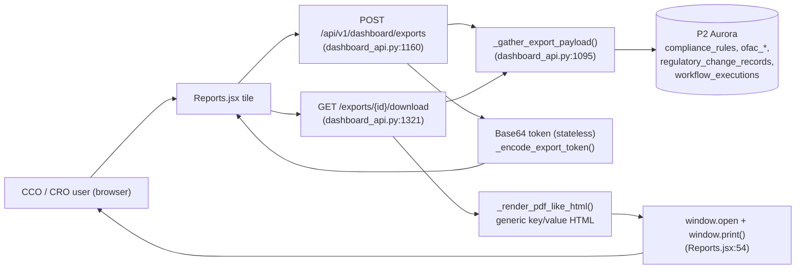

### 3.2 Current sequence

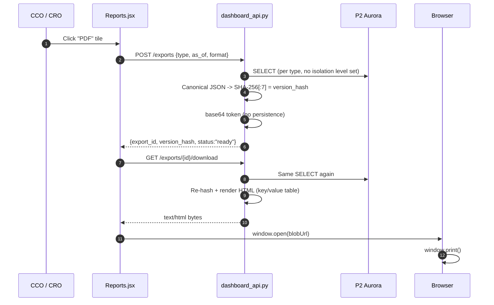

### 3.3 Current API surface (in `dashboard_api.py`)

| Endpoint | Lines | Notes |
|---|---|---|
| `POST /api/v1/dashboard/exports` | 1160-1194 | Stateless token; no S3, no persistence. |
| `GET /api/v1/dashboard/exports/{id}/download` | 1321-1366 | Re-gathers + re-renders. Returns HTML labelled `text/html` with `.html` extension. |
| `_gather_export_payload` | 1095-1151 | Per-type SELECTs; `mra_tracker` returns `[]` (no backing table). |
| `_render_pdf_like_html` | 1235-1318 | Generic Georgia-serif HTML, **does not match** any of the six gold templates. |
| `_canonical_export_bytes` | 1197-1203 | `json.dumps(sort_keys=True, default=str)` -> SHA-256 prefix. **Reusable** for §4 hash. |

### 3.4 Current DB schema (relevant subset)

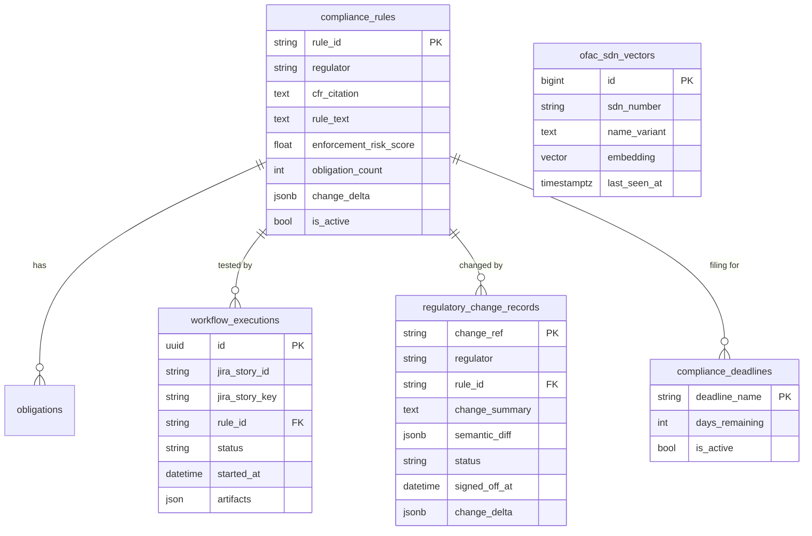

### 3.5 Current UI structure (`Reports.jsx`)

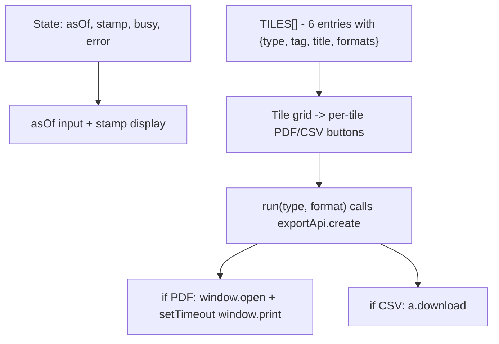

### 3.6 Gaps vs `prompt.md` (the as-is checklist)

| `prompt.md` requirement | Current | Gap |
|---|---|---|
| §2.1 server-render not browser-print | `window.print()` | **HARD GAP** — change everything below the API. |
| §2.2 hash data not PDF | `_canonical_export_bytes` already hashes data | **OK** — keep & extend with template/vocab version. |
| §2.3 immutable, retained, S3 keyed by `{bank,type,as_of,hash}` | Base64 token only | **HARD GAP** — needs S3 + DB row. |
| §2.4 point-in-time reproducibility | Reads "now" each call | **HARD GAP** — needs snapshot isolation + stored snapshot. |
| §2.5 footer on every page | None | **GAP** — needs Playwright `footerTemplate`. |
| §2.6 fixed vocabulary | No CHECK constraints, no Python Enum | **GAP** — needs DB CHECK + Enum + render validator. |
| §2.7 CSV companions with §4 columns | Generic column-from-payload CSV | **GAP** — per-type CSV writer. |
| §4 institution / charter / officers | Not in DB | **HARD GAP** — needs `bank_profile`, `bank_officers`. |
| §4 control + threshold + threshold_rationale + commit_hash + evidence_uri | Not in DB | **HARD GAP** — needs `controls`, `control_tests`, `test_executions`. |
| §4 findings 5 Cs + repeat_flag + root_cause | `findings: []` placeholder | **HARD GAP** — needs `findings` + history. |
| §4 OFAC list version + publication time + independent validation | `last_seen_at` only | **GAP** — needs `ofac_list_versions` (P1) + `ofac_validations` (P2). |
| §4 change disposition with vocab | Free-text `status` | **GAP** — needs `change_record_dispositions` + CHECK. |
| §4 coverage trend vs prior as-of | No history | **GAP** — automatic once artifacts are immutable. |

---

## 4. Target state (to-be per `prompt.md`)

### 4.1 High-level architecture (target)

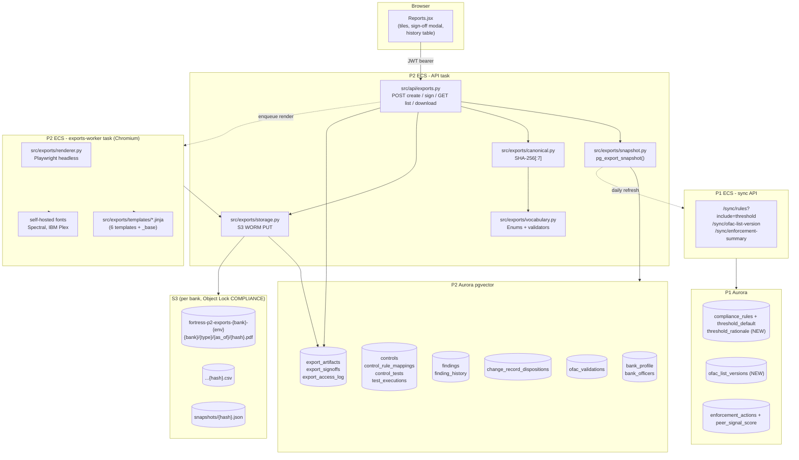

### 4.2 Component flow (per export request)

```mermaid
flowchart LR
  A["1. UI POST /exports<br/>{type, as_of}"] --> B["2. AuthZ: require_approver +<br/>bank_id == JWT.bank_id"]
  B --> C["3. snapshot.gather(type, as_of)<br/>REPEATABLE READ + pg_export_snapshot"]
  C --> D["4. canonical.hash(snapshot,<br/>template_ver, vocab_ver, app_commit)"]
  D --> E{"5. export_artifacts<br/>exists for<br/>(bank,type,as_of,hash)?"}
  E -- yes --> F["Return existing artifact_id<br/>(idempotent)"]
  E -- no --> G["6. PUT snapshot JSON to S3<br/>(WORM, KMS)"]
  G --> H["7. INSERT export_artifacts row<br/>(status=pending_render)"]
  H --> I["8. Enqueue render job<br/>(SQS -> exports-worker)"]
  I --> J["9. Worker: jinja render + Playwright<br/>page.pdf(footerTemplate)"]
  J --> K["10. PUT PDF/CSV to S3<br/>(WORM 5y, KMS)"]
  K --> L["11. UPDATE export_artifacts<br/>status=rendered, s3_etag, byte_size"]
  L --> M["12. UI shows artifact in history<br/>+ Sign button"]
  M --> N["13. POST /exports/{id}/sign<br/>INSERT export_signoffs"]
  N --> O{"All required<br/>signoffs present?"}
  O -- no --> M
  O -- yes --> P["14. status=sealed<br/>downloadable to external"]
  P --> Q["15. GET /download -> S3 GET<br/>INSERT export_access_log"]
```

### 4.3 Sequence — create export (point-in-time)

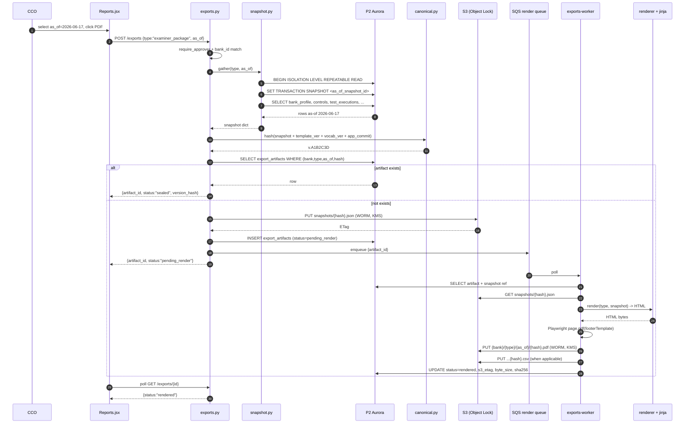

### 4.4 Sequence — sign-off and seal

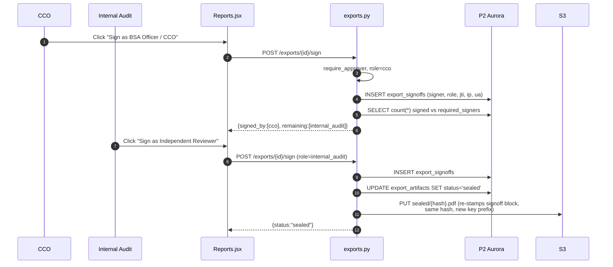

### 4.5 Sequence — download (every download is logged)

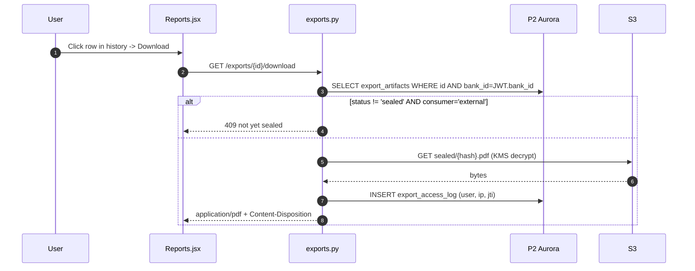

---

## 5. DB schema changes — split by pipeline

### 5.1 Pipeline 1 (Fortress Cloud — shared, source-of-truth)

Migration numbers continue from current head `037`.

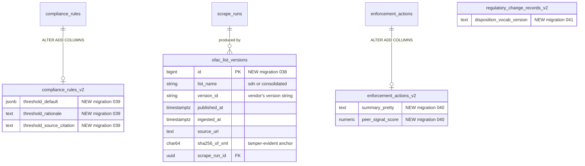

#### 5.1.1 P1 migration list

| # | DDL summary | Backfill |
|---|---|---|
| 038 | `CREATE TABLE ofac_list_versions (...)` + FK to `scrape_runs` | none — populated on next OFAC scrape |
| 039 | `ALTER compliance_rules ADD threshold_default JSONB, threshold_rationale TEXT, threshold_source_citation TEXT` | seed from `compliance_rule_resolver.py` constants (one-shot script) |
| 040 | `ALTER enforcement_actions ADD summary_pretty TEXT, peer_signal_score NUMERIC(5,2)` | seed via Bedrock summariser (background job) |
| 041 | `ALTER regulatory_change_records ADD disposition_vocab_version TEXT DEFAULT '2026-06'` | default fills existing rows |

#### 5.1.2 P1 sync API additions

| Verb | Path | Returns | Consumer |
|---|---|---|---|
| `GET` | `/sync/ofac-list-version` | latest row of `ofac_list_versions` | P2 `update_service._sync_ofac_list_versions()` |
| `GET` | `/sync/rules?include=threshold` | `compliance_rules` + new threshold cols | P2 `_sync_rules_with_thresholds()` |
| `GET` | `/sync/enforcement-summary?period=YYYY-Qn` | aggregate with `peer_signal_score` | P2 board_report snapshot |

### 5.2 Pipeline 2 (per-bank — where exports live)

P2 migrations are namespaced `NNNp2` because P1 and P2 have independent Alembic
heads (per CLAUDE.md schema table). Numbers continue from current P2 head.

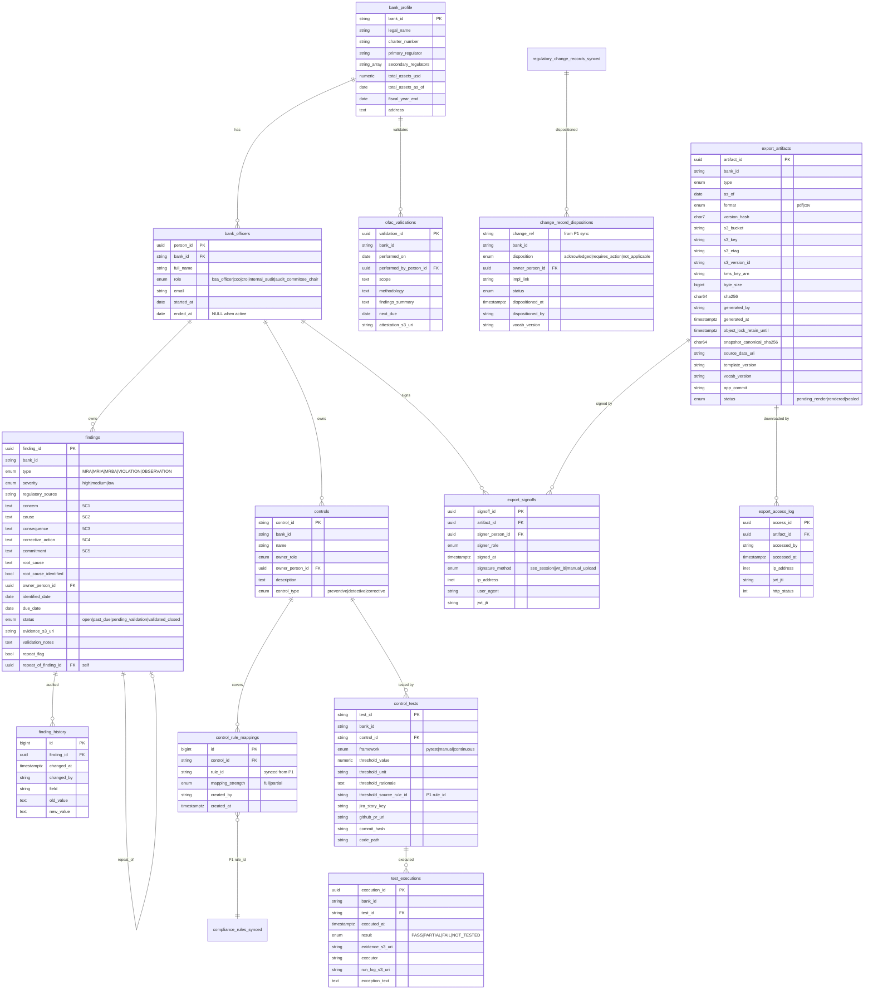

#### 5.2.1 P2 migration list

| # | Group | Purpose | Compliance anchor |
|---|---|---|---|
| 016p2 | A — identity | `bank_profile` | Cover-block source-of-truth (Call Report alignment) |
| 017p2 | A — identity | `bank_officers` | Officer attestation history (OCC Heightened Stds) |
| 018p2 | B — controls | `controls` | Named owner per control (OCC HS) |
| 019p2 | B — controls | `control_rule_mappings` | Coverage = mapped + tested |
| 020p2 | B — controls | `control_tests` + CHECK on `threshold_unit` | Trace columns §4 type 1 |
| 021p2 | B — controls | `test_executions` + CHECK on `result` enum | Vocab lock §2.6 |
| 022p2 | C — findings | `findings` + CHECK on `type` / `status` enums | 5 Cs lock §2.6 |
| 023p2 | C — findings | `finding_history` (trigger-driven) | OCC 2012-7 workpapers |
| 024p2 | D — change | `change_record_dispositions` + CHECK on `disposition` | Vocab §2.6 |
| 025p2 | E — OFAC | `ofac_validations` | OFAC 2019 Framework Pillar 4 |
| 026p2 | F — artifacts | `export_artifacts` UNIQUE(bank,type,as_of,hash) | Idempotency + immutability |
| 027p2 | F — artifacts | `export_signoffs` | E-signature audit chain |
| 028p2 | F — artifacts | `export_access_log` | FFIEC IT Handbook access logging |

---

## 6. UI → API → DB field mapping (per report)

Bold rows are **new** columns added by this design. Plain rows are existing.

### 6.1 Report 1 — `examiner_package`

| Template field (HTML) | UI source | API field | DB column |
|---|---|---|---|
| Institution name | metabox cell | `bank.legal_name` | **`bank_profile.legal_name`** |
| Charter & primary regulator | metabox | `bank.charter_number`, `bank.primary_regulator` | **`bank_profile.charter_number/primary_regulator`** |
| Total assets | metabox | `bank.total_assets_usd` | **`bank_profile.total_assets_usd`** |
| As of | UI date input | `request.as_of` | snapshot timestamp |
| Version `v.XXXXXXX` | hash | `version_hash` | **`export_artifacts.version_hash`** |
| Document ID | computed | `{type}-{as_of}-{hash6}` | derived |
| Prepared by | metabox | officer where role='cco' | **`bank_officers`** |
| Reviewed by | metabox | officer where role='internal_audit' | **`bank_officers`** |
| Obligations in scope | tile | count from snapshot | `compliance_rules` (synced) |
| With tested control | tile | count(rules with PASS test) | `control_rule_mappings` JOIN `test_executions` |
| Untested (gaps) | tile | inverse | derived |
| Trace row: rule_id | mono cell | `rule_id` | `compliance_rules.rule_id` |
| Trace row: regulator | cell | `regulator` | `compliance_rules.regulator` |
| Trace row: citation | mono cell | `cfr_citation` | `compliance_rules.cfr_citation` |
| Trace row: control_id | mono cell | `control_id` | **`controls.control_id`** |
| Trace row: control_owner | cell | officer name | **`bank_officers.full_name`** via `controls.owner_person_id` |
| Trace row: test_id | mono cell | `test_id` | **`control_tests.test_id`** |
| Trace row: threshold | cell | `threshold_value + unit` | **`control_tests.threshold_value/unit`** |
| Trace row: threshold_rationale | (not on row, in CSV) | `threshold_rationale` | **`control_tests.threshold_rationale`** |
| Trace row: result chip | chip cell | latest `test_executions.result` | **`test_executions.result`** |
| Trace row: executed_at | (CSV) | `executed_at` | **`test_executions.executed_at`** |
| Trace row: jira_key | mono cell | `jira_story_key` | **`control_tests.jira_story_key`** |
| Trace row: pr_url | mono cell | `github_pr_url` | **`control_tests.github_pr_url`** |
| Trace row: commit_hash | mono cell | `commit_hash` | **`control_tests.commit_hash`** |
| Trace row: evidence_uri | (CSV) | `evidence_s3_uri` | **`test_executions.evidence_s3_uri`** |
| Exceptions appendix: rule_id, reason | table | join | `compliance_rules` + missing `control_rule_mappings` |
| Exceptions remediation_ref | mono | FK to finding | **`findings.finding_id`** |
| Sign-off block | UI sign button | signoff insert | **`export_signoffs`** |

### 6.2 Report 2 — `ofac_attestation`

| Template field | API field | DB column |
|---|---|---|
| List version + publication time | `list.version_id, published_at` | **`ofac_list_versions`** (P1) |
| Ingested at | `list.ingested_at` | **`ofac_list_versions.ingested_at`** |
| Ingestion lag | derived `ingested_at - published_at` | computed |
| FUZZY/CLEAN/OWN50/FRESH controls | per-control row | `control_tests` filtered by `rule_id LIKE 'OFAC-SCREEN-%'` |
| Customers screened | from `screening_events` | `screening_events` aggregate |
| Beneficial owners | snapshot | `screening_events` group by `party_role='beneficial_owner'` |
| SDN entries / variants / embedded | engine coverage | `ofac_sdn_vectors` aggregate |
| Algorithm | constant | env var |
| Blocked / rejected | counts | `ofac_screenings.action` aggregate |
| Independent validation date + by whom | metabox | **`ofac_validations`** (P2) |

### 6.3 Report 3 — `board_report`

| Template field | DB column |
|---|---|
| Readiness score | derived from `compliance_rules` + `test_executions` (existing readiness endpoint) |
| Coverage % trend | compare current snapshot vs prior `export_artifacts.snapshot_canonical_sha256` |
| OFAC SLA | `ofac_list_versions` lag |
| Changes signed off | `regulatory_change_records.signed_off_at` count |
| Findings by severity | `findings` group by severity |
| SAR / CTR metrics | aggregate from existing `validation_api` results |
| Approval block | `export_signoffs` for CRO + Audit Committee |

### 6.4 Report 4 — `mra_tracker`

Every column maps 1:1 to a `findings` field. CSV columns exactly match the
prompt §4 type 4 list. The 2-3 "top findings expanded" section uses the same
`findings` rows but renders the 5 Cs as a card layout.

### 6.5 Report 5 — `change_log`

| Template field | DB column |
|---|---|
| change_ref, source, citation | synced `regulatory_change_records.*` |
| published_date / effective_date | `regulatory_change_records.created_at` |
| detected_date | `regulatory_change_records.created_at` |
| summary | `change_summary` |
| impact (affected control/policy) | derived from `control_rule_mappings WHERE rule_id=...` |
| disposition | **`change_record_dispositions.disposition`** |
| owner | **`change_record_dispositions.owner_person_id`** |
| impl_link | **`change_record_dispositions.impl_link`** |
| status | **`change_record_dispositions.status`** |

### 6.6 Report 6 — `coverage_gap`

Inverse of report 1. Same tables, different selection criteria
(`mapping_strength != 'full' OR latest test_executions.result NOT IN ('PASS')`).

---

## 7. Business logic per stage

### 7.1 Snapshot (`src/exports/snapshot.py`)

- Open a single read-only transaction per export: `BEGIN ISOLATION LEVEL REPEATABLE READ`.
- For point-in-time `as_of < today`: use stored snapshot ID from a daily
  pg_export_snapshot job (`export_snapshots` table — every nightly cron exports
  one snapshot id and retains it for 7 years). For `as_of == today`: live read.
- Every gatherer returns a `dict` matching a `pydantic` model in
  `src/exports/models/{type}.py` — these models are the contract that the
  template, CSV writer, and hash all share.

### 7.2 Canonical hash (`src/exports/canonical.py`)

```python
def canonical_bytes(payload, *, template_version, vocab_version, app_commit):
    envelope = {
        "payload": payload,
        "template_version": template_version,
        "vocab_version": vocab_version,
        "app_commit": app_commit,
    }
    return json.dumps(envelope, sort_keys=True, default=_stable_default).encode()

def version_hash(bytes_) -> str:
    return hashlib.sha256(bytes_).hexdigest()[:7].upper()
```

`_stable_default` formats `Decimal` to 2dp, dates to `YYYY-MM-DD`, datetimes to
ISO-8601 Z. Same payload, same hash — guaranteed.

### 7.3 Vocabulary enforcement (`src/exports/vocabulary.py`)

```python
class Decision(str, Enum):  # §2.6
    PASS = "PASS"; REVIEW = "REVIEW"; HOLD = "HOLD"

class FindingStatus(str, Enum):
    OPEN = "open"; PAST_DUE = "past-due"
    PENDING_VALIDATION = "pending-validation"
    VALIDATED_CLOSED = "validated-closed"

class ChangeDisposition(str, Enum):
    ACKNOWLEDGED = "acknowledged"
    REQUIRES_ACTION = "requires_action"
    NOT_APPLICABLE = "not_applicable"

# Render-time guard:
def assert_vocab(payload):
    for row in payload.get("trace", []):
        Decision(row["result"])          # raises -> 500 before render
```

DB CHECK constraints in migrations 020p2-024p2 mirror these enums (triple-lock).

### 7.4 Render (`src/exports/renderer.py`)

```python
async def render_pdf(template_name, payload, footer_ctx) -> bytes:
    html = jinja_env.get_template(template_name).render(**payload)
    async with async_playwright() as pw:
        browser = await pw.chromium.launch()
        page = await browser.new_page()
        await page.set_content(html, wait_until="networkidle")
        pdf = await page.pdf(
            format="Letter",
            print_background=True,
            margin={"top": "0.5in", "bottom": "0.7in", "left": "0.5in", "right": "0.5in"},
            display_header_footer=True,
            footer_template=footer_html(footer_ctx),   # institution · type · as_of · v.XXX · x/y
        )
        return pdf
```

Fonts vendored at `dashboard/public/fonts/` (Spectral, IBM Plex Sans, IBM Plex
Mono) and referenced via `@font-face` in `_base.html` so render is deterministic
offline (no Google Fonts dependency at render time).

### 7.5 S3 WORM PUT (`src/exports/storage.py`)

```python
def put_artifact(bytes_, *, bank_id, type_, as_of, hash_, fmt):
    key = f"sealed/{bank_id}/{type_}/{as_of}/{hash_}.{fmt}"
    s3.put_object(
        Bucket=f"fortress-p2-exports-{bank_id}-{env}",
        Key=key,
        Body=bytes_,
        ContentType={"pdf":"application/pdf","csv":"text/csv"}[fmt],
        SSEKMSKeyId=kms_key_arn(bank_id),
        ServerSideEncryption="aws:kms",
        ObjectLockMode="COMPLIANCE",
        ObjectLockRetainUntilDate=datetime.utcnow() + timedelta(days=1825),
        IfNoneMatch="*",   # idempotent: 412 PreconditionFailed if already exists
    )
```

### 7.6 Sign-off (`src/exports/signoff.py`)

- Required signers per type are defined in `src/exports/policy.yaml` (e.g.
  `examiner_package: [cco, internal_audit]`, `ofac_attestation: [bsa_officer, cro]`).
- Each `POST /sign` insert is checked against the artifact's required-signers
  list; status flips to `sealed` only when all required roles signed.
- A second-render pass re-stamps the PDF's signoff block with the actual names,
  dates, and IPs — but the **canonical hash is unchanged** because signatures
  live outside the canonical payload (they're metadata about the artifact, not
  part of the program-state being attested to).

### 7.7 Download (`src/exports/api.py`)

```python
@router.get("/exports/{id}/download")
async def download(id, user=Depends(require_approver)):
    art = await db.get(ExportArtifact, id)
    if not art or art.bank_id != user.bank_id: raise HTTPException(404)
    if art.status != "sealed": raise HTTPException(409, "awaiting signoff")
    body = s3.get_object(Bucket=art.s3_bucket, Key=art.s3_key)["Body"].read()
    await db.execute(insert(ExportAccessLog).values(
        artifact_id=id, accessed_by=user.email,
        ip_address=request.client.host, jwt_jti=user.jti, http_status=200,
    ))
    return StreamingResponse(BytesIO(body), media_type=art.content_type)
```

---

## 8. UI changes (`dashboard/src/pages/Reports.jsx`)

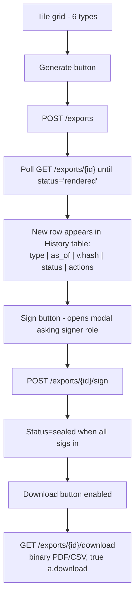

Key changes:
- Remove `window.open()` + `window.print()` (lines 53-55 of current `Reports.jsx`).
- New `<History>` sub-component showing rolling list of `export_artifacts` for
  the bank, with status chips that match the design-system chip palette.
- New `<SignoffModal>` shown when status is `rendered` but user is in
  `required_signers` and hasn't signed yet.
- Tile click no longer immediately downloads — it queues a render job and the
  user comes back when status is `sealed`.

---

## 9. Banking-compliance control map

| Control | Regulation / framework | Implementation |
|---|---|---|
| WORM 5-yr retention | FFIEC BSA, OFAC Reg §501.601, SEC 17a-4 (where applicable) | S3 Object Lock COMPLIANCE + 1825-day retention; `object_lock_retain_until` mirrored in `export_artifacts` |
| Tamper evidence | OCC 2011-12 SR 11-7 model risk | `snapshot_canonical_sha256` (pre-render) + PDF SHA-256 (post-render) + S3 versioning + source-data JSON stored under WORM |
| Tenant isolation | SOC 2 CC6 / FFIEC CAT | Per-bank S3 bucket, per-bank KMS CMK, `require_approver` enforces `bank_id` match |
| Audit trail | FFIEC IT Handbook §IV (audit), SOX 404 | `export_access_log` + S3 CloudTrail data events -> CW Logs 7-yr retention |
| Dual sign-off | OCC Heightened Standards Appendix D | `export_signoffs` rows for required roles; artifact `status='sealed'` gate before external download |
| Vocabulary lock | OCC 5 Cs (findings), OFAC PASS/REVIEW/HOLD | Triple lock: DB CHECK constraint + Python `Enum` + render-time validator |
| Point-in-time reproducibility | FFIEC IT Handbook §VI, OCC 2010-24 | `pg_export_snapshot()`-based gather + idempotent S3 key |
| Model risk governance | SR 11-7 | `template_version + vocab_version + app_commit` baked into hash envelope; same data + different template = different hash (visible to auditor) |
| Access governance | SOX 404, SOC 2 CC6 | `require_approver` (CCO/CRO); UI hides Sign / Download buttons by role |
| E-signature evidentiary value | ESIGN Act, UETA | `export_signoffs` captures JWT JTI + IP + UA + timestamp; PDF embeds same |

---

## 10. Phased migration plan

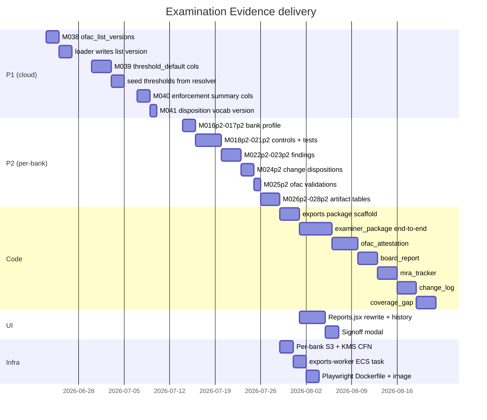

Each `cN` task is a self-contained PR per `prompt.md §1` (one type per PR), with
the §5 tests (vocabulary, determinism, immutability, required sections).

### 10.1 Revised PR sequence (with blocker mapping)

| PR | Pipeline | Scope | Open-question blockers |
|---|---|---|---|
| #1 | P1 | M038 + `ofac_list_versions` loader change | Q1, Q15 |
| #2 | P1 | M039 threshold-default cols + seed | Q1, Q6 |
| #3 | P1 | M040 enforcement summary + M041 disposition vocab version | Q1, Q16, Q18 |
| #4 | P2 | M016p2–028p2 (atomic schema for exports) | Q2 |
| #5 | Infra | Per-bank S3 + KMS CFN, exports-worker ECS, Dockerfile | Q3, Q4, Q7, Q8, Q21 |
| #6 | Code | `src/exports/{snapshot, canonical, vocabulary, storage, signoff, renderer}` + `_base.html` | Q9, Q10, Q11, Q12, Q17, Q18, Q19 |
| #7 | Code | Type 1 `examiner_package` end-to-end (template + CSV + tests) | Q14 |
| #8 | Code | Type 2 `ofac_attestation` (template + CSV + tests) | — |
| #9–#12 | Code | Types 3–6 (`board_report`, `mra_tracker`, `change_log`, `coverage`) — one PR each | Q5 (mra_tracker) |
| #13 | UI | `Reports.jsx` rewrite + history list + signoff modal | — |
| #14 | Obs | CloudTrail data events + CW alarms + quarterly drill test | Q22, Q23, Q24 |
| #15 | Docs | Bank onboarding runbook additions + `CLAUDE.md` memory entries | Q20 |

---

## 11. Open questions — RESOLVED 2026-06-21

All 24 decisions are locked. The 6 genuine forks (Q1, Q2, Q5, Q9, Q12, Q16)
were answered by product/eng on 2026-06-21; the other 18 are adopted as the
recommended defaults below. Implementation proceeds against this set; any
deviation requires a doc amendment.

### 11.1 Locked decisions (Q1, Q2, Q5, Q9, Q12, Q16)

| # | Decision | Resolved | Notes |
|---|---|---|---|
| Q1 | **P1 migrations 038–041 — PROCEED.** Additive nullable cols + new tables. | 2026-06-21 | Each migration ships with a `python -m alembic stamp <prev_head>` rollback recipe per `feedback_p1_alembic_blocks_rollback`. |
| Q2 | **P2 migrations 016p2–028p2 — ONE ATOMIC PR.** Schema-only, no code. | 2026-06-21 | Rollback = single `alembic downgrade -13`. |
| Q5 | **Findings backfill — OPTION A (ship empty, accumulate forward).** | 2026-06-21 | Pilot bank only. Hybrid CSV-import path added when second bank onboards. |
| Q9 | **Signer matrix locked** (see §11.5 below). | 2026-06-21 | Codified in `src/exports/policy.yaml`. CCO may amend post-rollout. |
| Q12 | **`board_report` quarter = FISCAL** (driven by `bank_profile.fiscal_year_end`). | 2026-06-21 | Mid-quarter `as_of` renders as "FQ2 partial" with preliminary notice. |
| Q16 | **Bedrock enforcement summariser — APPROVED (all three).** P1-only backfill with $50/batch cap; inline summarisation on new rows during ingestion; pre-flight script `scripts/setup/verify_bedrock_ready.py` added to bank-onboarding runbook. | 2026-06-21 | Fallback: `summary_pretty` NULL → renderer uses raw `summary`. |

### 11.2 Adopted defaults (Q3, Q4, Q6–Q8, Q10, Q11, Q13–Q15, Q17–Q24)

The following 18 carry the §11 recommendations forward as accepted defaults:

| # | Adopted default | PR landing |
|---|---|---|
| Q3 | Separate `exports-worker` ECS task def (Chromium isolated from API image) | #5 |
| Q4 | Per-bank S3 bucket `fortress-p2-exports-{bank}-{env}` | #5 |
| Q6 | **Threshold seed (M039) — GREEN-LIGHT.** `compliance_rule_resolver.py` constants migrate to `compliance_rules.threshold_default`; resolver reads DB. | #2 |
| Q7 | S3 Object Lock = **COMPLIANCE** mode, 1825-day default retention | #5 |
| Q8 | Per-bank KMS CMK; bank can revoke on offboarding | #5 |
| Q10 | **Strong signing** (typed full name + acknowledgement checkbox + JWT JTI) for `examiner_package` + `ofac_attestation`; JTI-only for others | #6 |
| Q11 | Document ID = deterministic `{type}-{as_of}-{hash6}` (no counter table) | #6 |
| Q13 | Snapshot-history: daily `pg_export_snapshot()` cron + retention table; lands as PR #6.1 | #6.1 |
| Q14 | Audit `workflow_executions.artifacts` JSON for `commit_hash` / `pr_url` / `jira_key` before PR #7; wire agents to write them if missing | #7 |
| Q15 | Loader parses `Publish_Date` / `Version` from `SDN_ADVANCED.XML`; fallback to source-URL `Last-Modified` header | #1 |
| Q17 | Sample-note strip: `` block in `_base.html`; test asserts absence in prod renders | #6 |
| Q18 | Vocab-version registry: new table `vocab_versions(version_id, frozen_at, vocab_json)` as **M029p2** (appended to PR #4) | #4 |
| Q19 | Regulator → 5 Cs mapping in `src/exports/regulator_mapping.py`; one rule set per primary regulator; CCO review before PR #6 ships | #6 |
| Q20 | Bank-onboarding runbook updates: per-bank CMK, S3 bucket, `bank_profile` seed, officer roster, control catalogue, Bedrock pre-flight | #15 |
| Q21 | PDF streams through API (`GET /exports/{id}/download`); pre-signed S3 URLs are not exposed externally | #6 |
| Q22 | CloudTrail data events on exports bucket → CW Logs, 7-year retention | #14 |
| Q23 | Three CW alarms (render-failure rate, sign-off SLA breach, retention near-expiry), all with dimensioned + dimensionless variants per `feedback_cw_alarm_dimension_split` | #14 |
| Q24 | Quarterly re-attestation drill: cron tests past `as_of` returns stored artifact, not a new render; Slack post on drift | #14 |

### 11.3 Note: Q2 + Q18 combined

PR #4 lands **M016p2–029p2** (14 migrations, not 13) — the originally
scoped 13 plus `vocab_versions` from Q18. Schema is still atomic for
rollback (`alembic downgrade -14`).

### 11.4 Note: Q9 (signer matrix detail)

Locked matrix (`src/exports/policy.yaml`):

| Report type | Required signers |
|---|---|
| `examiner_package` | CCO + Internal Audit (dual) |
| `ofac_attestation` | BSA Officer + CRO (dual) |
| `board_report` | CCO (single) |
| `mra_tracker` | CCO (single) |
| `change_log` | CCO (single) |
| `coverage` | CCO (single) |

Dual-signer artifacts require 2 rows in `export_signoffs` before
`GET /download` unlocks the final (un-watermarked) PDF.

---

## 12. References

- `dashboard/prompt.md` — authoritative spec
- `dashboard/0[1-6]*.html` — gold templates (visual contract)
- `dashboard/src/pages/Reports.jsx` — current UI
- `src/api/dashboard_api.py:1037-1366` — current export code
- `src/models/database.py` — current ORM
- `CLAUDE.md` — migrations 007-037 history
- `docs/runbooks/agent-4-sync.md` — P1 -> P2 sync mechanics
- OFAC 2019 Framework, OCC Heightened Standards Appendix D, FFIEC BSA Manual,
  SR 11-7, ESIGN Act / UETA
