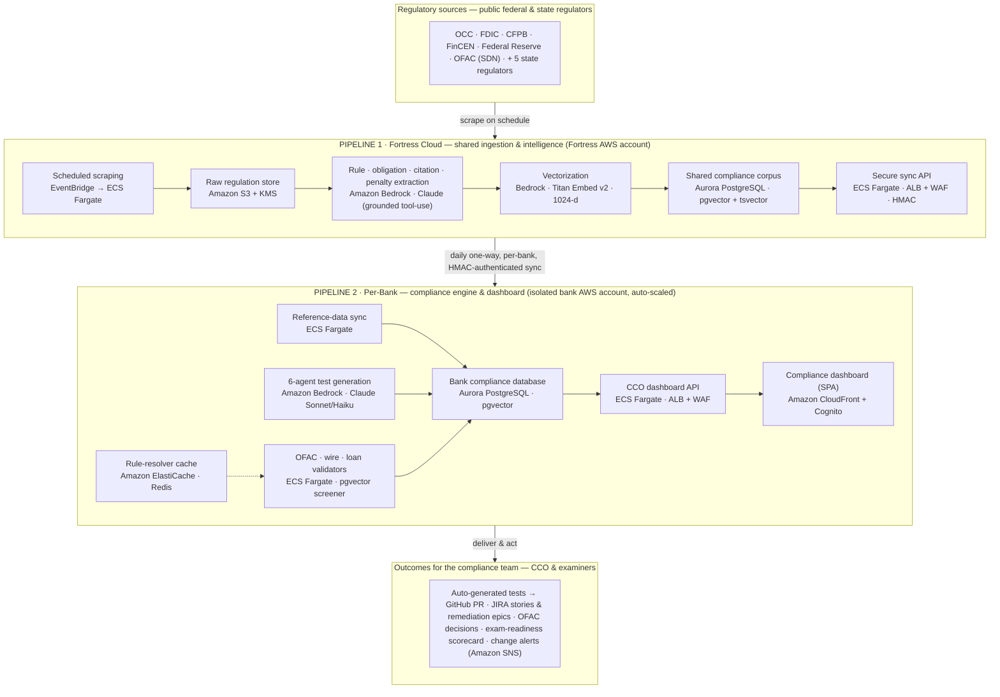

# Fortress Labs — Architecture & AWS POC Funding Brief

> **Prepared for AWS partner review.** AI-native BSA/AML compliance automation for U.S. community banks, built end-to-end on AWS with Amazon Bedrock at the core.

---

## The ask

POC funding to run the AWS-intensive milestones that take Fortress from a built
platform to live community-bank pilots: full-corpus **Amazon Bedrock** extraction
& embedding, OFAC vector-screener calibration, and per-bank pilot stacks. The
platform is engineered and running end-to-end; funding de-risks the steps gated
on real AWS inference and infrastructure spend, not on further build.

| | |
|---|---|
| **20+** | Federal & state regulatory sources ingested automatically |
| **6** | AI agents from a rule to tested, review-ready compliance code |
| **0** | EC2 instances — fully serverless, container-native on AWS |
| **180+** | BSA/AML rules scoped to each bank's charter & asset tier |

---

## The problem — small banks carry a big-bank regulatory load with a two-person team

A community bank is examined against the same Bank Secrecy Act, AML, OFAC, and
consumer-protection rules as a money-center bank — but with a compliance function
of one or two people and no in-house data engineering. The regulations change
constantly, span a dozen federal agencies and fifty states, and are published as
prose, not data. A single missed obligation can become a consent order or civil
money penalty that dwarfs the cost of the control that would have prevented it.

- **Rules live in PDFs and press releases** — tracking what applies to *this* bank is manual and perpetually stale.
- **No test coverage of obligations** — examiners ask "show me the control," and there's a spreadsheet, not evidence.
- **OFAC screening is noisy** — legacy fuzzy matching floods a tiny team with false positives.
- **Enforcement signals are ignored** — peers get fined for the same gaps, with no early-warning loop.

---

## What Fortress does — from raw regulation to exam-ready control coverage

Each capability is **grounded**: foundation models extract and generate strictly
against the bank's own regulatory corpus, so citations map to real rules and
nothing is invented.

| Capability | What it does |
|---|---|
| **Living regulatory corpus** | Scheduled scrapers pull federal & state regulators; Amazon Bedrock extracts machine-readable rules, obligations, citations, and penalties with grounded tool-use — no hallucinated citations. |
| **6-agent test generation** | A pipeline of six specialized agents turns a compliance rule into runnable, review-ready test code, opened as a pull request with the obligation's citation in every assertion. |
| **Vector OFAC & transaction validators** | An embedding-based SDN screener plus wire, CTR/SAR, and loan validators — tuned to cut false positives a small team can't triage. |
| **Regulatory-change tracking** | Rule mutations are detected at ingest, diffed, and routed to the CCO as an actionable change — optionally opening a remediation epic and refreshing affected tests. |
| **Enforcement intelligence** | Peer enforcement actions are parsed and scored per regulation, so controls and testing focus on what regulators are actively penalizing — dollar-weighted. |
| **CCO exam-readiness dashboard** | One source of truth for applicable rules, coverage gaps, pending actions, and a readiness scorecard the compliance officer takes into an exam. |

---

## Architecture — two AWS planes

Public regulatory intelligence is computed **once** in Fortress Cloud and synced,
one-way and authenticated, into each bank's isolated AWS account. **No bank data
ever leaves its own plane.**

**Cross-cutting across both planes:** AWS CloudFormation (IaC) · Amazon ECR
(images) · Amazon CloudWatch (EMF metrics + alarms) · AWS Secrets Manager (P1) ·
SSM Parameter Store (P2) · VPC isolation.

---

## Built on AWS — an AWS-native stack, by design

Fortress deliberately standardized on managed AWS services: **Aurora's pgvector
is the sole vector + keyword store** (replacing a separate search cluster), and
**Amazon Bedrock is the only model provider** in production.

| AWS service | Role in Fortress |
|---|---|
| **Amazon Bedrock** | The AI core. Claude (Sonnet/Haiku) for grounded rule & obligation extraction, 6-agent test generation, and enforcement summarization; Titan Embed v2 for 1024-dim vectors. The primary driver of POC compute. |
| **Aurora PostgreSQL** | Single source of truth and the **only** vector + BM25 store — pgvector (HNSW) for semantic search and tsvector for keyword ranking, per-plane. Removes the need for a dedicated search engine. |
| **Amazon ECS · Fargate** | Runs both pipelines as serverless containers — EventBridge-triggered scraper tasks on P1, auto-scaled agent + API + validator services on each P2. |
| **Amazon EventBridge** | Schedules the regulatory scrape cycle without standing infrastructure. |
| **Amazon S3 + AWS KMS** | Encrypted store for raw regulatory chunks and the OFAC SDN source — the durable record behind every extraction. |
| **CloudFront + Cognito** | Delivers and authenticates the CCO dashboard (React SPA) per bank. |
| **ALB + AWS WAF** | Ingress and IP-allowlisting for each bank's API — the authenticated boundary for the one-way sync. |
| **Amazon ElastiCache · Redis** | Hot cache for the tiered compliance-rule resolver. |
| **Secrets Manager / SSM** | Per-plane configuration and secrets — Secrets Manager on P1, SSM Parameter Store on each P2 tenant. |
| **Amazon CloudWatch** | Observability via embedded-metric-format records and alarms on scrape, extraction, and health. |
| **CloudFormation · ECR** | All infrastructure as code; container images in ECR for reproducible per-bank deploys. |
| **Amazon SNS** | Change alerts and operational digests to the compliance team. |

---

## What the POC funds — four milestones, AWS consumption mapped

| # | Milestone | What it covers | AWS consumption |
|---|---|---|---|
| **01** | **Full-corpus extraction & embedding** | Run grounded Bedrock extraction and Titan v2 embedding across the complete federal + state obligation set and the OFAC SDN list, backfilling the shared corpus end-to-end. | Amazon Bedrock · Aurora pgvector · S3 |
| **02** | **OFAC vector-screener calibration** | Build the HNSW index, calibrate per-class match thresholds against real screening history, and A/B the vector screener versus legacy fuzzy matching on 1,000+ real wires. | Bedrock · Aurora · CloudWatch |
| **03** | **Community-bank pilot stacks** | Stand up isolated per-bank Pipeline 2 environments for the first pilot banks — Aurora, ECS, CloudFront/Cognito, WAF — and run the live rule → test → exam-readiness loop. | ECS Fargate · Aurora · CloudFront · Cognito · WAF |
| **04** | **Production hardening** | Security review, KMS/WAF posture, CloudWatch alarm coverage, and autoscaling validation for exam-season load — the bar for handling a regulated institution's data. | AWS WAF · KMS · CloudWatch · CloudFormation |

### Why this is a strong AWS POC

The value scales **with** AWS, not around it. Fortress's core — foundation-model
extraction and generation on Amazon Bedrock, grounded by Aurora pgvector — grows
directly with AWS consumption. Every community bank onboarded is a new isolated,
auto-scaled AWS footprint. The POC converts a working architecture into
measurable Bedrock and Aurora usage against a concrete, regulated-industry buyer.

---

*Fortress Labs — AI-native BSA/AML compliance for community banks. Confidential; for partner evaluation.*
