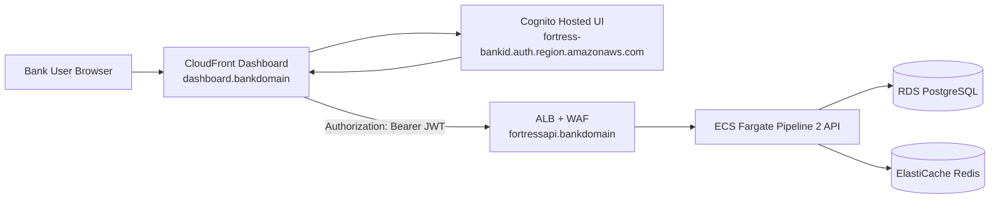

# Pipeline 2 Dashboard to API Production Integration

Date: 2026-06-12  
Scope: Production connection between dashboard frontend and Pipeline 2 API backend

## 1. Objective

Define the exact production path for dashboard users to authenticate via Cognito and call Pipeline 2 API endpoints securely.

## 2. Production Endpoints and Domains

In production mode (TrialMode=false):

1. Dashboard URL: https://dashboard.<BankDomain>
2. API URL: https://fortressapi.<BankDomain>
3. Cognito hosted UI domain: https://fortress-<BankId>.auth.<Region>.amazoncognito.com

Source templates:

1. infra/cloudformation/pipeline2-dashboard.yml
2. infra/cloudformation/pipeline2-compute.yml

## 3. Connection Architecture

## 4. Auth and API Flow

Frontend behavior:

1. Dashboard SPA initializes Amplify with:
  - VITE_COGNITO_USER_POOL_ID
  - VITE_COGNITO_CLIENT_ID
  - VITE_COGNITO_DOMAIN
2. Redirects are computed from window.location.origin:
  - /auth/callback
  - /auth/logout
3. On successful login, dashboard acquires Cognito token and sets:
  - Authorization: Bearer <token>
4. Axios client sends API calls to VITE_API_URL.

Backend behavior:

1. Pipeline 2 API validates Bearer token using Cognito JWKS.
2. Access control is enforced by Cognito groups:
  - CCO, CRO, CIO, Analyst, Admin
3. CORS allowlist must include dashboard origin in production.

Source files:

1. dashboard/src/main.jsx
2. dashboard/src/App.jsx
3. dashboard/src/services/api.js
4. src/api/auth.py
5. src/main_pipeline2.py
6. src/utils/config.py

## 5. Required Production Configuration

## 5.1 CloudFormation parameters

Pipeline 2 compute stack:

1. TrialMode=false
2. BankDomain=<bank domain>
3. ImageUri=<production image>

Pipeline 2 dashboard stack:

1. TrialMode=false
2. BankDomain=<bank domain>
3. P2ApiUrl=https://fortressapi.<BankDomain>

## 5.2 SSM parameters used by dashboard deploy

Required keys:

1. /fortress/<BankId>/COGNITO_USER_POOL_ID
2. /fortress/<BankId>/COGNITO_CLIENT_ID
3. /fortress/<BankId>/P2_API_URL

The dashboard deployment script reads these parameters and writes .env.production build values.

Source file:

1. dashboard/deploy.sh

## 5.3 Required API runtime env for CORS and auth

Mandatory values in production:

1. ALLOWED_ORIGINS must include only explicit origins, for example:
  - https://dashboard.<BankDomain>
2. ALLOWED_ORIGINS must not be empty.
3. ALLOWED_ORIGINS must not include *.
4. COGNITO_USER_POOL_ID and COGNITO_CLIENT_ID must be set.
5. DEV_MODE should remain false in production.

## 6. DNS and TLS Requirements

1. API DNS:
  - CNAME fortressapi.<BankDomain> -> Pipeline 2 ALB DNS output
  - ACM certificate validation complete for fortressapi.<BankDomain>
2. Dashboard DNS:
  - CNAME dashboard.<BankDomain> -> CloudFront distribution domain
  - ACM certificate validation complete for dashboard.<BankDomain>
3. WAF is associated to ALB for API edge protection.

## 7. Deployment Order (Production)

1. Deploy pipeline2-vpc.yml
2. Deploy pipeline2-data.yml
3. Deploy pipeline2-compute.yml with TrialMode=false and BankDomain
4. Confirm API endpoint health over HTTPS
5. Deploy pipeline2-dashboard.yml with TrialMode=false and P2ApiUrl
6. Build and deploy dashboard assets using dashboard/deploy.sh
7. Validate Cognito login and API calls end to end

## 8. Validation Checklist

1. Open https://dashboard.<BankDomain> and complete Cognito login.
2. Confirm browser requests to https://fortressapi.<BankDomain>/api/v1/dashboard/* return 200.
3. Confirm Authorization Bearer header is present in requests.
4. Confirm no browser CORS errors.
5. Confirm /health and dashboard endpoints are healthy through ALB.
6. Confirm role-based UI behavior by Cognito group.
7. Confirm WAF does not block normal dashboard/API usage.

## 9. Common Production Misconfigurations

1. P2_API_URL points to trial CloudFront domain instead of production API domain.
2. ALLOWED_ORIGINS missing dashboard domain, causing CORS failure.
3. Cognito callback/logout URLs do not match dashboard production domain.
4. TrialMode accidentally left true in compute or dashboard stack.
5. ACM cert validation incomplete, causing TLS/DNS cutover issues.

## 10. Recommended Go-Live Gates (Dashboard to API)

1. Successful Cognito auth from production dashboard domain.
2. Successful authenticated API reads and writes from dashboard.
3. No CORS or token validation errors in CloudWatch logs for 24h soak.
4. WAF baseline tuned and no false-positive blocking during UAT.
5. Security team sign-off on role mapping and origin allowlist.
